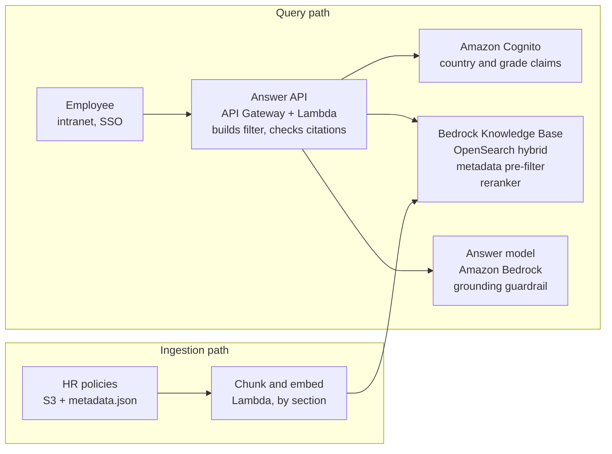

# Case Study 01: Permission-Aware RAG for HR Policies

Status: Accepted · Date: 2026-10-09 · Cloud: AWS (eu-central-1)

We answer HR policy questions with hybrid-search RAG on AWS (Amazon Bedrock Knowledge Bases over OpenSearch Serverless), filtering chunks by the employee's country and grade before the model sees them, so every answer is cited and nobody sees a policy they are not entitled to.

Decisions are recorded in [ADR-001](adr/ADR-001-hybrid-search.md), [ADR-002](adr/ADR-002-access-control-in-retrieval.md) and [ADR-003](adr/ADR-003-section-based-chunking.md).

## Problem

Globex Corp (a mocked company) has 20,000 employees in 12 countries and about 4,000 HR policy documents: leave, travel, benefits, parental leave, remote work and expenses. Policies differ by country and by employee grade, and HR updates around 40 documents a week.

The first chatbot was built in two weeks. It loaded the top matching documents into a long prompt and asked the model to answer. Within a month, HR logged three kinds of failures:

- **Wrong country:** an employee in India was told the UK parental leave entitlement, because both documents matched "parental leave" equally well.
- **Leaked policy:** a junior employee received details from the executive relocation policy, which is restricted to senior grades.
- **Uncited and stale answers:** answers had no source link, and some quoted a travel policy that had been replaced two weeks earlier.

The chatbot was paused. HR's service desk still handles about 6,000 policy questions a month, most of which are answered somewhere in the documents.

**Who is affected:** employees (wrong decisions about leave and pay), HR operations (ticket volume), Legal and Compliance (restricted policies exposed), and IT Security (data access outside entitlement).

## Requirements and constraints

The hard constraint is access control: a wrong answer is bad, but a restricted policy shown to the wrong person is a compliance incident.

| ID | Requirement | Target | Why it matters |
| --- | --- | --- | --- |
| R1 | Users only retrieve documents allowed for their country and grade | Zero cross-entitlement retrievals in testing | Compliance; the reason the first bot was paused |
| R2 | Every answer cites its source sections | 100% of answers carry at least one citation | Employees and HR can verify |
| R3 | Answer the right country's version of a policy | 95% correct-document retrieval on the test set | The top failure in production |
| R4 | Say "I don't know" and route to HR when no policy covers the question | Under 2% confident answers with no supporting source | Hallucinated policy is worse than no answer |
| R5 | Policy updates searchable quickly | Within 1 hour of publishing | Stale answers were the third failure |
| R6 | Response time | p95 under 3 seconds to first token | Used inside the intranet and Slack |
| R7 | Scale | 6,000 questions a month, peak 50 per minute in open-enrollment weeks | Sizing and cost |
| R8 | Data residency | All data and inference in eu-central-1 (Frankfurt) | Mocked company policy for employee data |
| R9 | Cost | Under $2,000 a month for search and models | Must be cheaper than the HR desk time it saves |
| R10 | Team skills | Run by a 3-person platform team already on AWS | Prefer managed services over self-hosted |

**Out of scope for v1:** questions about an individual's own data ("how many leave days do I have left"), which need HR system integration and belong in a later agent case study.

## Options considered

Hybrid-search RAG with security filters is the only option that meets R1 (access control) and R2 (citations) at the same time.

| Option | How it works | Access control (R1) | Cites sources (R2) | Fresh within 1 hour (R5) | Verdict |
| --- | --- | --- | --- | --- | --- |
| A. Fine-tune a model on all policies | Train policy knowledge into weights | No: every user queries the same weights | No | No: retrain on every change | Rejected |
| B. Long context, send many documents | Dozens of documents per prompt | Only if filtered first, which is RAG anyway | Weakly | Yes | Rejected |
| C. Pure vector RAG | Embed chunks, retrieve by similarity | Yes, with filters | Yes | Yes | Rejected, fails R3 |
| D. Hybrid RAG + reranker + security filters | Keyword and vector search, reranked, filtered by identity | Yes | Yes | Yes | **Chosen** |

**Why not A, fine-tuning.** Fine-tuning is a poor way to store facts that change weekly. A model cannot say which document a fact came from, so R2 fails, and knowledge in shared weights cannot be hidden from a junior employee.

**Why not B, long context.** Sending 100,000 tokens per question costs far more than 3,000 retrieved tokens, models miss facts buried in long prompts, and once you filter by entitlement you have built a retrieval system anyway.

**Why not C, pure vector RAG.** The UK and India policies mean almost the same thing. What separates them are exact terms: country names, policy codes and grade labels. Keyword search (BM25) catches those; vector search catches paraphrases. We need both.

**What D costs us.** More moving parts: an index with security fields, a reranking step that adds latency, and keeping entitlement metadata current.

## Architecture

The Answer API is the only component that talks to both identity and search: it reads country and grade from the verified token, calls the Knowledge Base `Retrieve` API with a hybrid query and a metadata filter it builds itself, and passes only the top 5 allowed chunks to the model. Ingestion is the only writer to the index.

## Request walkthrough

Priya, a grade-5 engineer in Bengaluru, asks "How many weeks of parental leave do I get?"

1. **Sign-in.** API Gateway validates her Cognito token with a JWT authorizer before any code runs.
2. **Resolve entitlements.** The Lambda reads `country` (IN) and `grade_band` (G1-6) from the verified claims, never from the request body.
3. **Rewrite the query (optional).** A small model turns a follow-up into a standalone question. It never sees or changes the security filter.
4. **Hybrid search with filter.** `Retrieve` with search type `HYBRID` and an explicit `andAll` filter of `listContains(allowed_countries, "IN")` and `listContains(allowed_grades, "G1-6")`.
5. **Rerank.** A Bedrock reranker reorders the candidates; we keep the top 5.
6. **Relevance gate.** If the best score is below a tuned threshold, skip the model, say no policy covers it, and offer an HR ticket (R4).
7. **Generate.** The answer model receives the question and 5 labeled chunks, must answer only from them and cite them. A Bedrock Guardrail grounding check blocks unsupported answers.
8. **Validate citations.** Every cited chunk ID must have been retrieved; otherwise the fallback reply is used.
9. **Respond and log.** The trace (query, retrieved IDs, scores, latency, tokens) goes to CloudWatch and X-Ray; answer text is kept no longer than 30 days.

**Ingestion.** HR publishes a policy to S3 with a `.metadata.json` sidecar (countries, grades, effective date, version, status). An S3 event triggers a Knowledge Base sync; a custom chunking Lambda splits by section. Superseded versions are excluded by the filter.

## Cloud mapping and cost

| Component | AWS service | Role |
| --- | --- | --- |
| Retrieval | Amazon Bedrock Knowledge Bases | Managed ingestion, `Retrieve` with hybrid search, metadata filters, reranking |
| Index | Amazon OpenSearch Serverless (vector collection) | Chunks, embeddings, metadata; required for hybrid search and `listContains` |
| Models | Amazon Bedrock | Embeddings, reranker, query rewrite, answers |
| Grounding | Amazon Bedrock Guardrails | Contextual grounding check; denied topics |
| Identity | Amazon Cognito federated with the corporate IdP | Verified `country` and `grade_band` claims |
| Documents | Amazon S3 | Policies plus `.metadata.json` sidecars |
| Ingestion | S3 events, EventBridge, chunking Lambda | Sync and section-based chunking |
| API | API Gateway (JWT authorizer) + Lambda | Token, filter, retrieval, model, citation check |
| Security | IAM roles, KMS, VPC endpoints | No keys in code; private traffic |
| Monitoring | CloudWatch, X-Ray, Bedrock invocation logging | Traces, latency, tokens, no-answer rate |

**Two AWS details that shape the design**

- Bedrock runs hybrid search only on RDS, OpenSearch Serverless and MongoDB stores; other stores silently fall back to semantic search.
- Security uses only the explicit metadata filter, never Bedrock's model-generated implicit filter.

**Managed alternative noted:** Amazon Q Business offers connector-level permissions. We build the pipeline ourselves so every decision is visible and testable.

**Cost drivers (estimate; confirm in the AWS Pricing Calculator):** about 24 million input and 1.8 million output tokens a month; the OpenSearch Serverless minimum capacity, likely the largest fixed cost at this volume; reranking per query; small embedding updates. Lambda, API Gateway and Cognito are negligible.

## Failure modes and evaluation

| Failure mode | Detection | Mitigation |
| --- | --- | --- |
| Wrong country or grade version | Retrieval test set with expected document per question | Hybrid search (ADR-001) |
| Restricted content retrieved | Cross-entitlement tests per country and grade | Explicit filter from token (ADR-002) |
| Wrong or stale identity claims | Daily comparison with HR system of record | Claims from the IdP's HR feed; drift alerts |
| Missing or wrong metadata | Ingestion check for valid `.metadata.json` | Reject documents without metadata |
| Unsupported answer | Grounding score; citation validation | Strict prompt, guardrail, fallback reply |
| Superseded policy quoted | Version and effective-date tests | Status filter |
| Prompt injection in a document | Red-team documents in the test set | Chunks treated as data; no tools in v1 |
| Answers when nothing applies | Out-of-scope questions | Relevance gate (R4) |
| Latency over 3 seconds | p95 in CloudWatch and X-Ray | Smaller rewrite model, fewer chunks, streaming |

**Evaluation set:** 60 questions (30 single-country, 15 that differ by country, 10 out-of-scope, 5 restricted-policy probes), scored with the shared harness in `shared/evals`: hit rate at 5, section hit rate, MRR@5, cross-entitlement count (target 0), refusal and citation metrics.

## POC scope

The POCs prove two claims: hybrid beats semantic-only on country-specific questions, and access control holds.

| POC | Question it answers | Validates |
| --- | --- | --- |
| 1. Chunking strategy | Do section-based chunks keep rules with their conditions? | ADR-003 |
| 2. Retrieval strategy | Semantic vs hybrid vs hybrid + reranker, without the security filter | ADR-001 |
| 3. Access control | Does the token-built filter bring cross-entitlement retrievals to zero? | ADR-002 |
| 4. Grounding and refusal | Does the system refuse when no policy applies, and cite correctly? | R2, R4 |
| 5. Evaluation | Are all numbers reproducible from the shared harness? | All |

**Results table** (filled in from the POCs):

| Configuration | Hit@5 | Wrong-country retrievals | Cross-entitlement | p95 latency |
| --- | --- | --- | --- | --- |
| Semantic only | to measure | to measure | to measure | to measure |
| Hybrid | to measure | to measure | to measure | to measure |
| Hybrid + reranker | to measure | to measure | to measure | to measure |

**Left out on purpose:** intranet and Slack integration, real IdP federation, chat history, production networking.

## What changes at 10x scale

- Entitlements outgrow two attribute lists; move to a dedicated authorization service such as Amazon Verified Permissions.
- Cache repeated questions (open-enrollment spikes), leading into the LLM gateway case study.
- Split indexes by region for data residency.
- Personal questions need tools into the HR system, which turns this into an agent.
