# Case 02: Invoice Extraction with Human Review

**Cloud:** AWS · **Status:** Design · **Blog post:** *Invoice Extraction with Human Review: Route on Checks, Not on Confidence* (Medium)

> Composite scenario on synthetic invoices. Numbers are planning figures, not benchmark results.

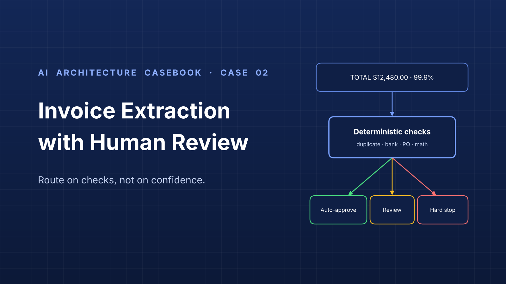

## 1. Problem

A mid-sized distributor receives about 6,000 supplier invoices a month as PDFs, scans and phone photos. Three accounts-payable clerks re-key vendor, invoice number, dates, line items, tax, total and PO into the ERP.

Goal: extract automatically and send only uncertain invoices to a person.

The hard question: **how does the system know it is unsure?** Extraction confidence measures reading, not correctness. An invoice read at 99.9% can still be a duplicate, have no open PO, or ask to pay a new bank account.

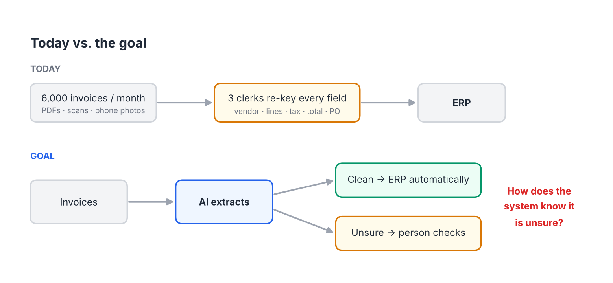
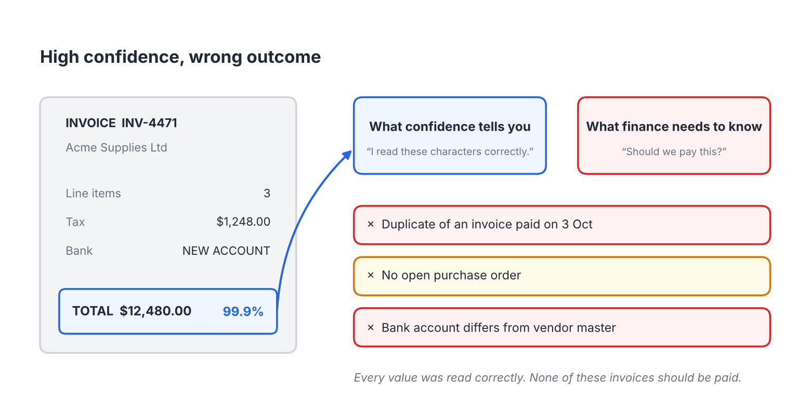

## 2. Requirements

**Functional**
- Extract header fields and line items from PDF, scan and photo invoices.
- Validate every invoice against vendor master, open POs and payment history.
- Route each invoice to auto-approve, review or hard stop, with reasons.
- Let reviewers confirm or correct only the flagged fields.
- Post approved invoices to the ERP.

**Non-functional**
- Routing is deterministic and auditable: same input, same route, with a list of reasons.
- No model output can approve a payment that fails a hard-stop check.
- Measurable escaped error rate on auto-approved invoices.
- Extractor replaceable without changing business rules.

**Out of scope:** payment execution, vendor onboarding, ERP changes.

## 3. Architecture

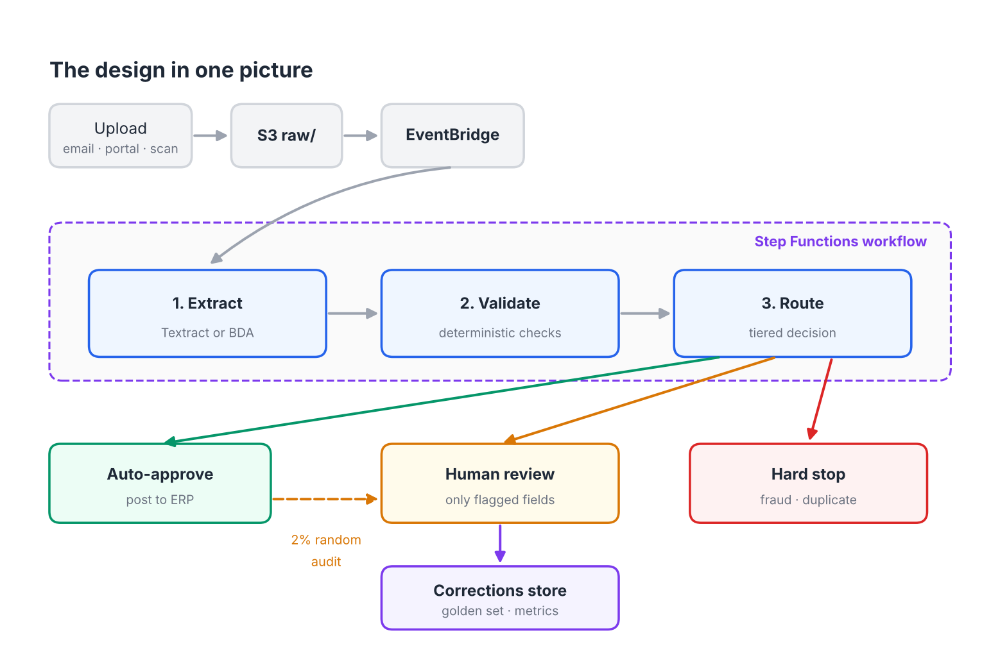

| Component | AWS service | Responsibility |
|---|---|---|
| Intake | S3 (`raw/`), EventBridge | Store uploads, start the workflow |
| Orchestration | Step Functions | Extract → validate → route → review → post |
| Extraction | Textract AnalyzeExpense (BDA as alternative) behind an adapter | Return a normalized `Invoice` |
| Validation | Lambda | Run deterministic checks against vendor master, POs, payment history |
| Routing | Lambda | Apply routing order; attach reasons |
| Review queue | DynamoDB | Pending reviews, reasons, reviewer, SLA, task token |
| Review UI | Web app + Cognito | Show flagged fields with highlights; confirm or correct |
| Corrections store | DynamoDB or S3 + Athena | Corrections, audit results, golden set |
| ERP posting | Lambda / integration | Post approved invoices |

## 4. Key decisions

| ADR | Decision |
|---|---|
| [ADR-001](adr/ADR-001-route-on-verified-checks.md) | Route on verified checks, not model confidence |
| [ADR-002](adr/ADR-002-per-field-confidence-thresholds.md) | Confidence thresholds per field, set by the cost of error |
| [ADR-003](adr/ADR-003-extractor-behind-adapter.md) | Put the extractor behind an adapter |
| [ADR-004](adr/ADR-004-build-review-loop-not-a2i.md) | Build the review loop in-house instead of Amazon A2I |
| [ADR-005](adr/ADR-005-random-audit-for-escaped-errors.md) | Measure escaped errors with a random audit |

## 5. Extraction

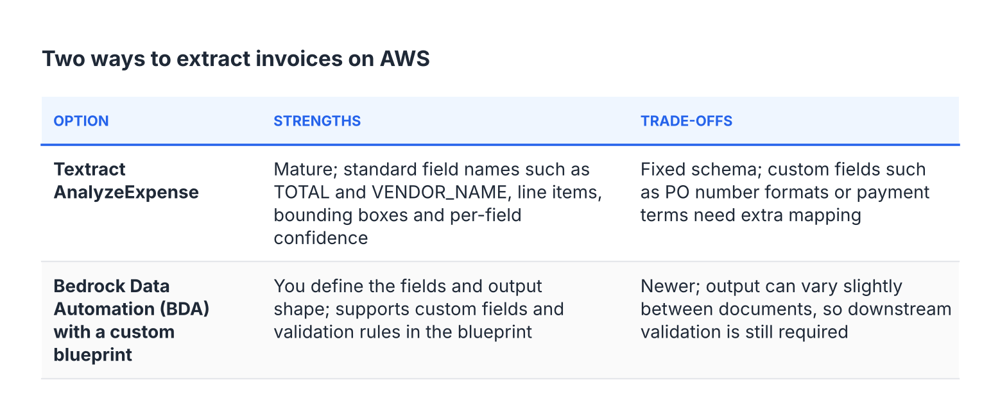
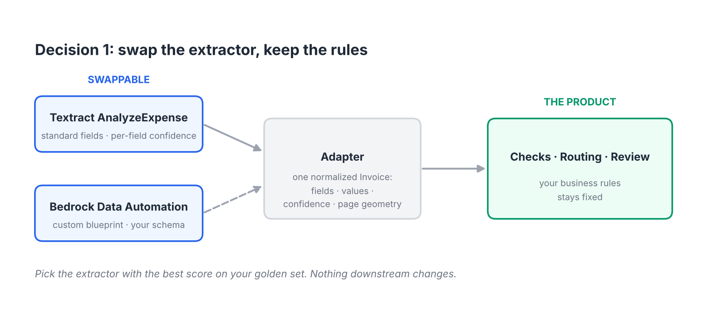

Normalized `Invoice` object:

```
Invoice
  vendor_name, vendor_tax_id, bank_account
  invoice_number, invoice_date, due_date, currency
  po_number, subtotal, tax, total
  lines[]: description, quantity, unit_price, amount
  per field: value, confidence (0-100), page, bbox
```

## 6. Validation and routing

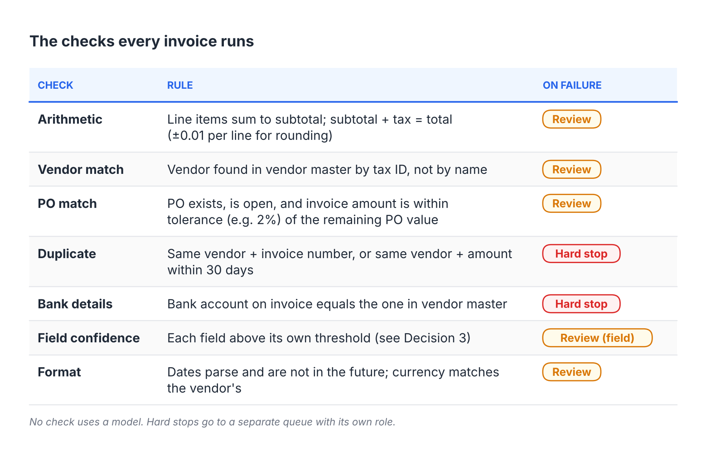
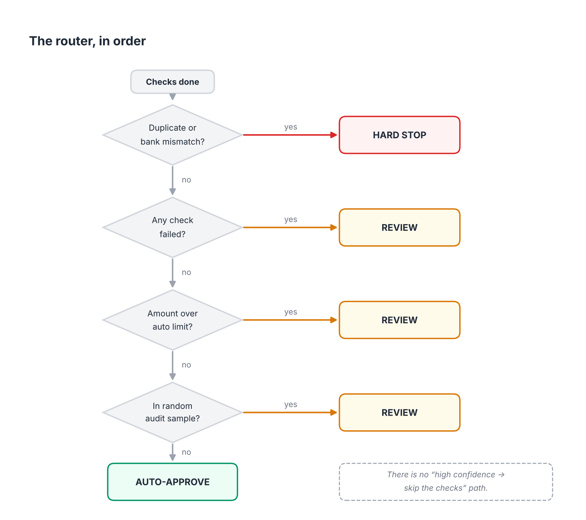

Routing order: hard stop (duplicate, bank mismatch) → review (any failed check) → review (amount over limit) → review (audit sample) → auto-approve. No confidence shortcut.

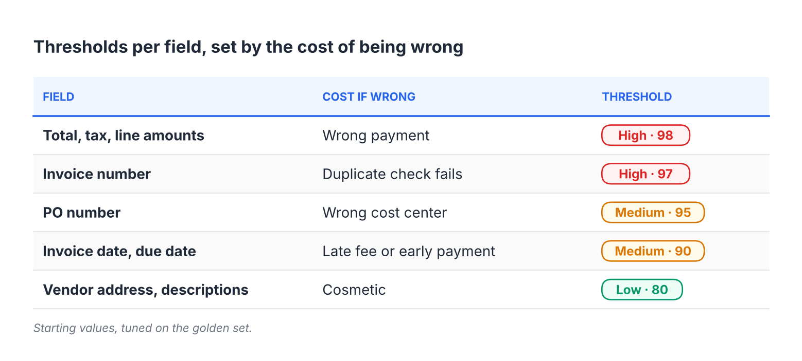

## 7. Human review

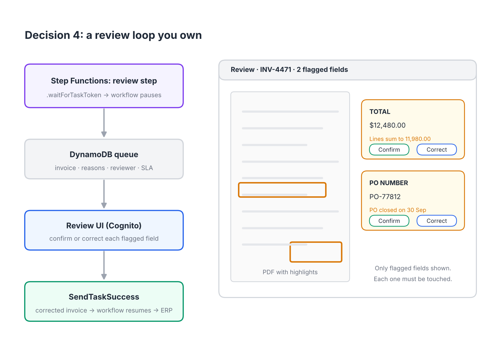

- Workflow pauses with `.waitForTaskToken`; UI resumes it with `SendTaskSuccess`.
- Only flagged fields shown, each with its reason and highlighted region.
- Every flagged field must be confirmed or corrected.
- Hard stops: separate queue, vendor-management role, four-eyes rule, phone confirmation for bank changes.
- Task tokens time out and escalate.

## 8. Measurement

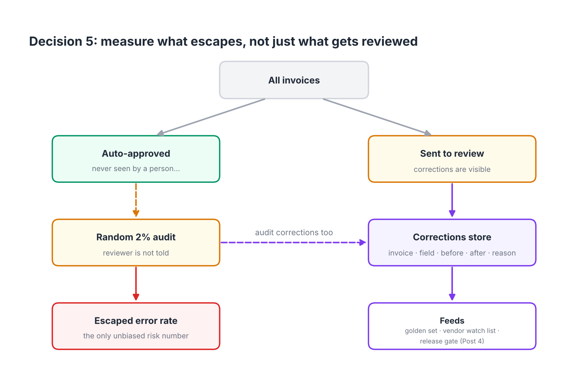
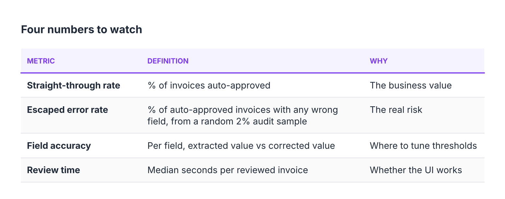

## 9. Rollout

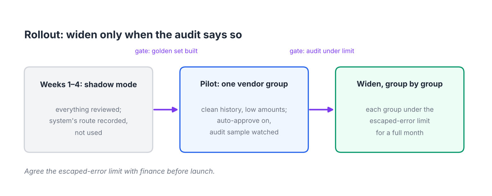

1. Weeks 1–4: shadow mode. Everything reviewed; system route recorded.
2. Auto-approve for one vendor group with clean history and low amounts.
3. Widen group by group after a full month under the escaped-error limit.

Planning target: 40–60% straight-through rate early on, depending on vendor mix.

## 10. Risks

| Risk | Mitigation |
|---|---|
| Stale vendor master causes false reviews | Treat master data as part of the system; track review reasons |
| Fraud via changed bank details | Hard stop; never update from invoice; phone confirmation |
| Threshold drift after extractor change | Re-tune on golden set; release gate |
| Reviewer fatigue / rubber-stamping | Flagged fields only; must touch each field; audit sample hidden |
| Review queue backlog | SLA timestamps, task-token timeouts, escalation |

## 11. Open questions

- Escaped-error limit per field (finance to agree).
- Auto-approve amount limit.
- Retention period for invoice images and corrections.
