# Case 03: Keeping a Team Knowledge Assistant in Sync

**Cloud:** Google Cloud · **Status:** Design · **Blog post:** *Keeping a Team Knowledge Assistant in Sync: Index on Change, Retrieve on Question* (Medium)

> Composite scenario. System names, tables and numbers are illustrative.

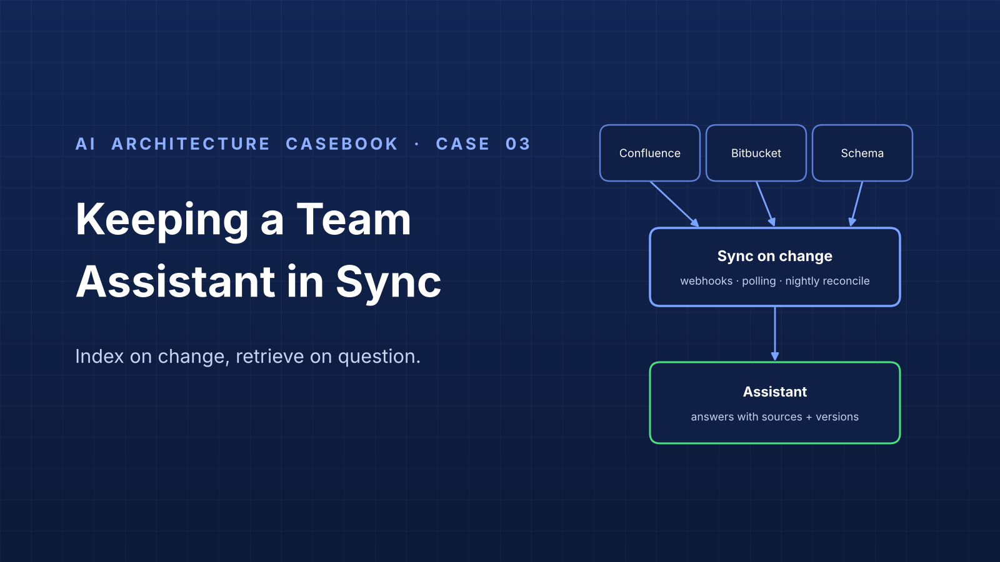

## 1. Problem

**ClaimFlow** is the claims backend of a mid-sized insurer. Our team owns ClaimFlow only:

| System | Owner | Role |
|---|---|---|
| Claims Portal | Portal team | UI |
| Claims Intake | Integration team | Preprocessing: cleans and enriches claims |
| **ClaimFlow** | **Our team** | Business rules, claim lifecycle, claims database |

Knowledge sources: **Bitbucket** (code and migrations), **Confluence** (business-team feature specs, runbooks), and a **relational database** (~80 tables).

A team chat assistant helps new members understand the business, how tables connect, how the code works, and write troubleshooting SQL. It answers from a single context document built by hand with ChatGPT. That context goes stale every time a feature ships, cannot hold all sources, blends spec, code and schema, and has no citations.

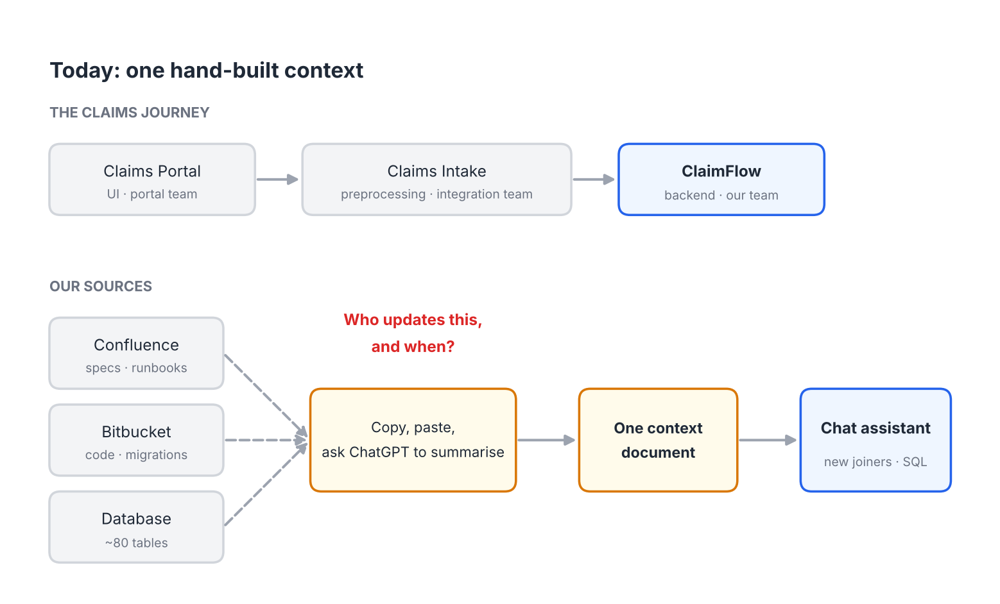
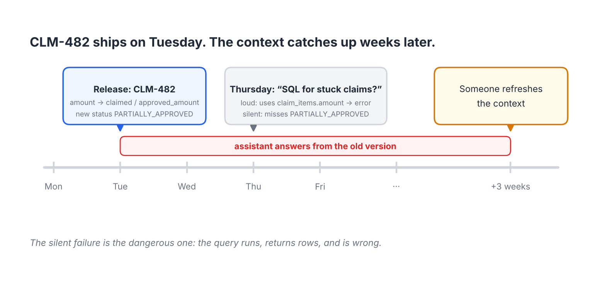

**Goal:** keep the assistant current automatically as code, Confluence and schema change, with every answer traceable to its source.

## 2. Requirements

**Functional**
- Answer questions about process, tables, code and troubleshooting, citing sources.
- Generate read-only SQL that is valid against the current schema.
- Pick up code merges, page edits and schema migrations without a manual step.

**Non-functional**
- Freshness: code and schema within minutes of merge; Confluence within 15 minutes; worst case one day.
- Read-only access to all sources; no customer rows indexed.
- Respect Confluence page restrictions per user.
- Each answer shows source versions.

**Out of scope:** changing how specs are written; automated code or data changes; a company-wide assistant; other teams' internal code.

## 3. Architecture

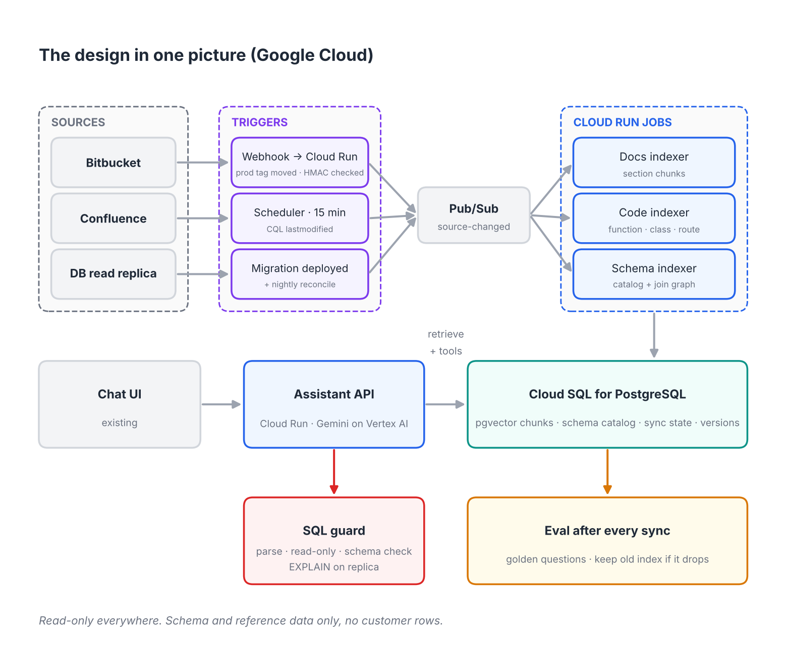

| Component | Google Cloud service | Responsibility |
|---|---|---|
| Webhook receiver | Cloud Run (public, signature-verified) | Receive Bitbucket `repo:push`; verify `X-Hub-Signature`; publish changed paths |
| Schedulers | Cloud Scheduler | Confluence poll (15 min); nightly reconcile and schema refresh |
| Event bus | Pub/Sub (`source-changed`) | Decouple triggers from indexers; retries |
| Indexers | Cloud Run jobs | Docs, code and schema indexers |
| Store | Cloud SQL for PostgreSQL + pgvector | Chunks, embeddings, full-text index, schema catalog, join graph, sync state, versions |
| Embeddings | Vertex AI text embedding model | Embeddings for docs and code chunks |
| Assistant API | Cloud Run + a Gemini model on Vertex AI | Retrieval, tool calls, answer composition with citations |
| SQL guard | Inside Assistant API | Parse, read-only check, schema check, EXPLAIN on replica |
| Evaluation | Cloud Run job | Golden set after each sync; blue/green index switch |
| Secrets | Secret Manager | Bitbucket webhook secret, API tokens, DB read-only credentials |

## 4. Key decisions

| ADR | Decision |
|---|---|
| [ADR-001](adr/ADR-001-retrieve-from-indexed-sources.md) | Retrieve from indexed sources instead of a hand-built summary |
| [ADR-002](adr/ADR-002-sync-on-change-reconcile-nightly.md) | Sync on change, reconcile on schedule |
| [ADR-003](adr/ADR-003-one-representation-per-source.md) | Give each source its own representation |
| [ADR-004](adr/ADR-004-source-precedence-and-conflicts.md) | Each source is authoritative for one question; show conflicts |
| [ADR-005](adr/ADR-005-sql-guard-never-execute.md) | Validate generated SQL against the live schema; never execute it |
| [ADR-006](adr/ADR-006-freshness-and-eval-after-sync.md) | Show freshness on every answer; evaluate after every sync |
| [ADR-007](adr/ADR-007-code-chunks-and-module-summaries.md) | Chunk code by symbol; rebuild module summaries only when their input changes |

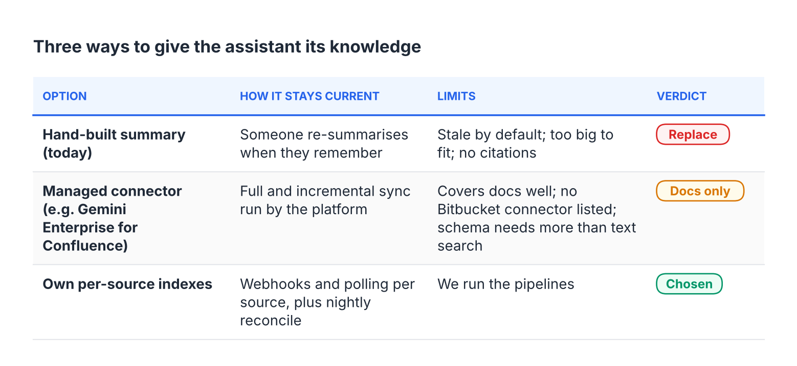

## 5. Sync

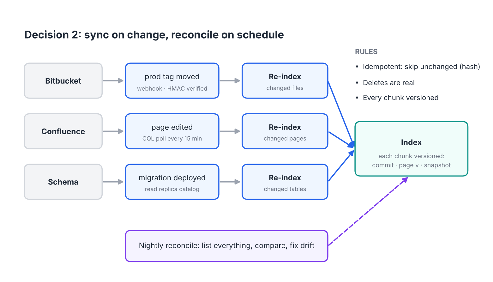

Rules: idempotent (content hash), deletes are removed, every chunk versioned, sync state stored per source.

## 6. Data model (store)

```
chunk(id, source, source_id, version, hash, title, path_or_url,
      feature_key, restrictions[], text, embedding vector, tsv tsvector,
      updated_at, deleted bool)

schema_table(name, comment, snapshot_at)
schema_column(table, name, type, nullable, comment, snapshot_at)
schema_fk(from_table, from_col, to_table, to_col)
status_value(domain, value, description, snapshot_at)   -- reference tables only

sync_state(source, last_success_at, cursor)
index_version(id, created_at, eval_pass_rate, active bool)
```

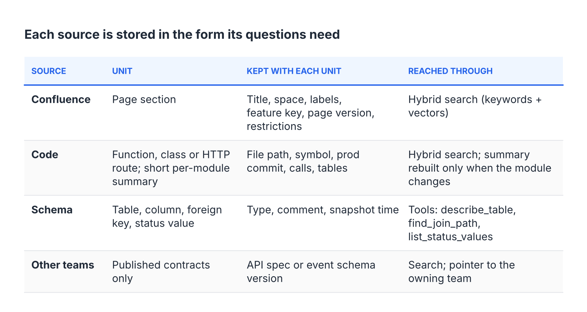

## 7. Code indexing (Node.js)

Runs when the deploy pipeline moves the `prod` tag (ADR-002), so the index describes the code running in production. Details in [ADR-007](adr/ADR-007-code-chunks-and-module-summaries.md).

1. **What changed:** `git diff --name-status -M <oldProd> <newProd>`; files read with `git show <ref>:<path>`, no checkout.
2. **Parse:** TypeScript compiler API (handles JavaScript and TypeScript).
3. **Chunks:** one per function (declarations, arrow functions, `exports.x`, `module.exports` members, class methods), one per Express route (`POST /claims/:id/approve-partial`), one outline per class and per file. Tiny functions fold into outlines; functions over 150 lines split at statement boundaries.
4. **Key and hash:** stable key per symbol or route; hash over code only, so unchanged code is skipped on every deploy.
5. **Metadata:** calls, tables (knex, raw SQL, Sequelize, TypeORM, Prisma) and relative imports, linking code to the schema catalog and to other modules.
6. **Module summaries:** module = directory; input hash = hash of its chunk hashes; regenerate only when it changes, from a digest of routes, exports, signatures, JSDoc, calls and tables. Stored as generated, with commit, model and prompt version. Never edited by hand.

Example route chunk:

```
// path: src/routes/claims.routes.js
// in: router  symbol: POST /claims/:id/approve-partial
// commit: a1b2c3d
/** Partial approval of a claim (CLM-482). */
router.post('/claims/:id/approve-partial', requireRole('adjuster'), async (req, res) => {
  const result = await approval.approvePartial(req.params.id, req.body.decisions);
  res.status(200).json(result);
});
```

Example module digest (input to the summary prompt):

```
MODULE src/services

FILE src/services/approval.service.js
  exports: approvePartial, getClaim, isFinal
  imports: ../db, ../domain/claimStatus, ../pool
  FUNCTION async function approvePartial(claimId, decisions)
    doc: /** Approve some items of a claim and reject the rest (CLM-482). */
    calls: db, db.where
    tables: claim_items, claims
  FUNCTION getClaim = async (req, res) =>
    calls: pool.query, res.json
    tables: claim_status_history, claims
```

Reference implementation and rollout steps: [`src/code-index/`](src/code-index/).

## 8. Answering

1. Classify the question (process, code, schema, SQL).
2. Hybrid search over docs and code, filtered by the user's Confluence access.
3. Schema questions use tools: `describe_table`, `find_join_path`, `list_status_values`.
4. Compose the answer with citations and versions. If sources disagree, cite both (ADR-004).

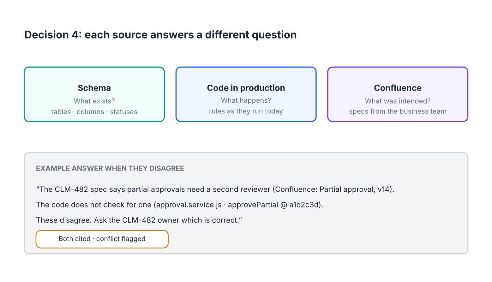

## 9. SQL guard

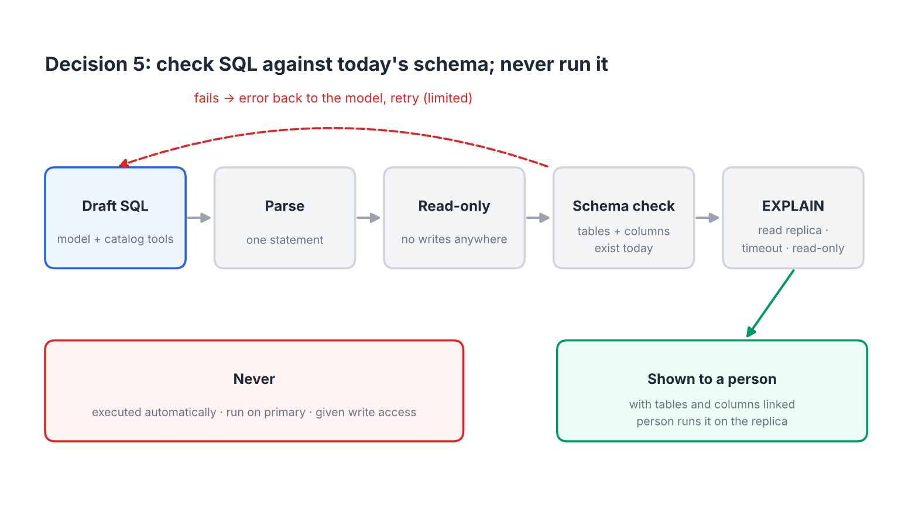

Reference implementation: [`src/sql_guard.py`](src/sql_guard.py), tests in [`src/test_sql_guard.py`](src/test_sql_guard.py).

## 10. Freshness and evaluation

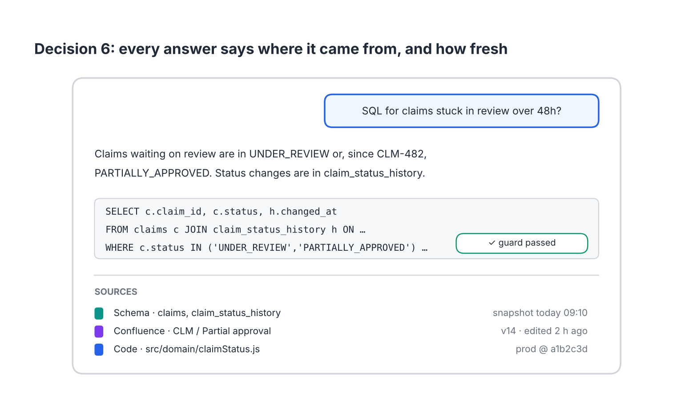
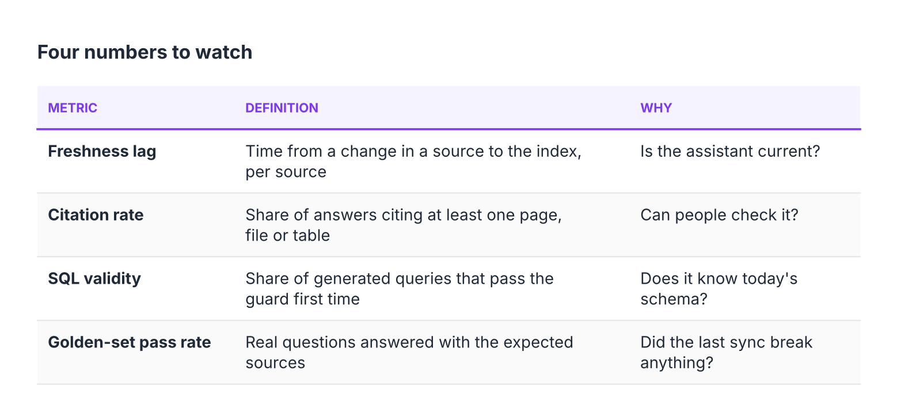

## 11. Rollout

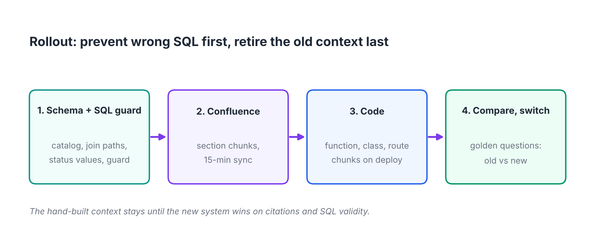

1. Schema catalog and SQL guard.
2. Confluence indexing with 15-minute sync.
3. Code indexing on merge.
4. Run the golden set against old context and new indexes; retire the hand-built context when the new system wins.

## 12. Risks

| Risk | Mitigation |
|---|---|
| Missed webhook or failed sync | Nightly reconcile; freshness alert |
| Deleted content still answered | Tombstones; reconcile removes |
| Restricted page leaks | Restrictions on each chunk; retrieval filter; test |
| Bad pipeline change degrades answers | Eval after sync; blue/green index switch |
| SQL exposes personal data | Never executed by the assistant; read replica; person runs it |
| Silent SQL errors (missing status) | Status values from reference tables; golden-set SQL questions |
| Other teams' facts go stale | Only published contracts indexed; pointer to owner |
| Module summary says something the code doesn't | Summary built from a digest of routes, signatures and JSDoc only; marked as generated; regenerated on change; fix the code docs, not the summary |

## 13. Open questions

- Feature key convention in Confluence titles and commit messages (ask the business team).
- Which reference tables are on the allow-list.
- Golden-set pass threshold for promoting a new index.
- Code chunk thresholds (tiny ≤ 4 lines, split > 150 lines) to tune on the golden set.
- How the deploy pipeline marks the production commit (moving `prod` tag assumed).
- Whether to use a managed Confluence connector for the docs part instead of our docs indexer.
