# Case 04: An LLM Gateway That Cut the Bill

**Cloud:** Google Cloud · **Status:** Design (ADRs proposed), post ready · **Blog post:** *An LLM Gateway That Cut the Bill: Meter First, Then Route* (`post.md`)

> Composite scenario. Apps, teams and numbers are illustrative planning figures, not benchmark results.
> Links back to Case 01 (access decided by data, so no cross-user cache); forward to Case 05 (evaluation gate for tier changes).

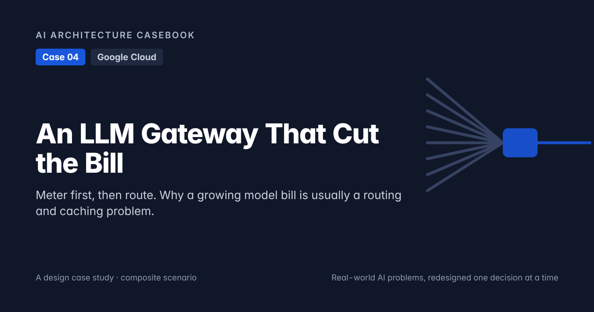

## 1. Problem

Nine internal apps call Gemini models directly: service accounts, two API keys, one shared key. Monthly model spend grew from ~$11k (January) to ~$48k (September). All calls land in one project; the bill shows models and tokens, not apps or features. Finance asks which team is spending, on what, and whether it is worth it. Nobody can answer.

Quick fixes proposed: "switch everyone to the cheapest model" (breaks the use cases that need a stronger model) and "negotiate a discount" (a discount on waste is still waste).

**Core problem:** you can't cut a bill you can't attribute. Meter every call, then route each use case to the cheapest model that passes its evaluation, and cache what repeats.

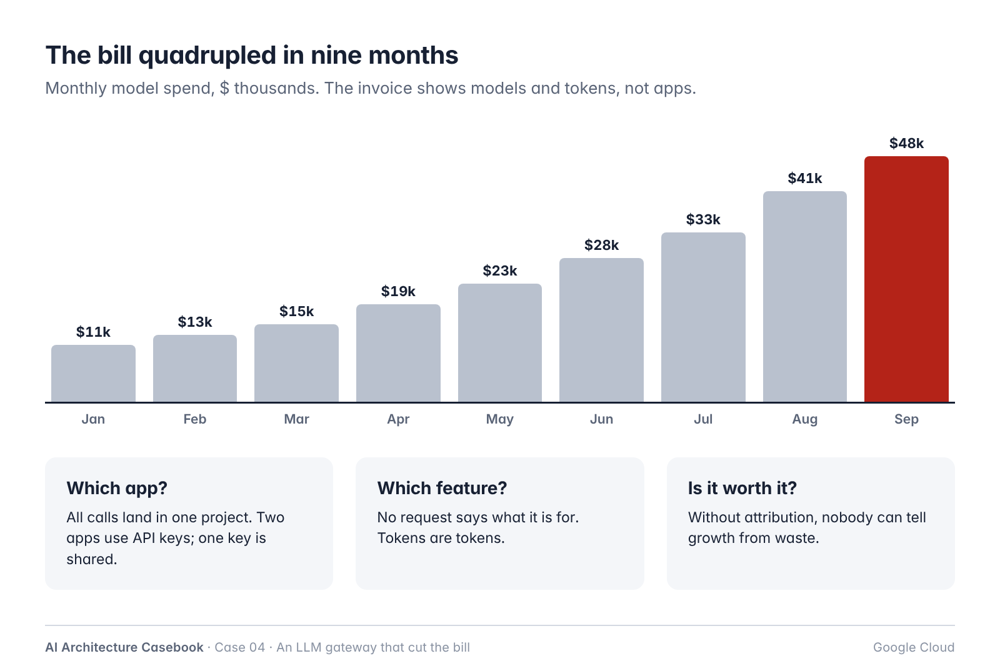

## 2. Requirements

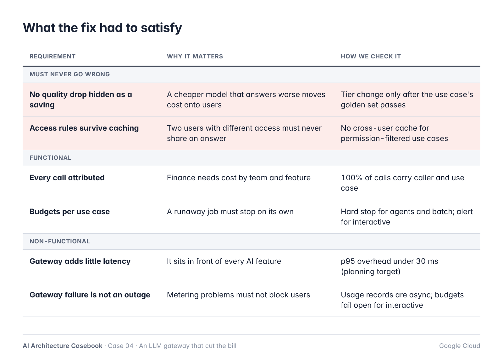

**Must never go wrong**
- No quality drop hidden as a saving: a tier change needs a passing golden set.
- Caching never crosses user permissions.

**Functional**
- Every model call attributed to caller, use case and owning team.
- Budget per use case; runaways stop on their own.
- Tier (model) chosen per use case from config; pinned model versions.
- Caching: prompt-prefix, exact-response (deterministic use cases), batch for deferrable work.

**Non-functional**
- Gateway p95 overhead under 30 ms (planning target).
- Metering never blocks a request.
- Gateway is stateless, regional, horizontally scaled.

**Out of scope:** changing app prompts beyond ordering rules; per-request model routing; negotiating pricing.

## 3. Architecture

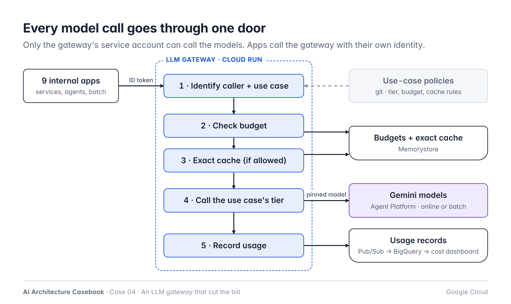

```
App (own service account) ──ID token + use_case──► LLM gateway (Cloud Run, internal)
                                                       1 identify caller + use case  ◄── policies.yaml (git)
                                                       2 check budget                ──► Memorystore (counters)
                                                       3 exact cache (if allowed)    ──► Memorystore (cache)
                                                       4 call the use case's tier    ──► Gemini models (Agent Platform)
                                                                                         online · batch inference
                                                       5 record usage                ──► Pub/Sub ──► BigQuery ──► dashboard, alerts
```

| Component | Google Cloud service | Responsibility |
|---|---|---|
| Gateway | Cloud Run (internal ingress, IAM-authenticated) | Identify caller, enforce policy, cache, call model, record usage |
| Policies | Git repo, deployed with the gateway | Use cases: owner, callers, tier, budgets, cache rules, retries |
| Counters and exact cache | Memorystore for Redis | Budget counters per use case; exact-response cache |
| Models | Gemini models on Gemini Enterprise Agent Platform (formerly Vertex AI) | Online calls; implicit/explicit context caching |
| Batch | Agent Platform batch inference | Deferrable jobs (nightly enrichment) |
| Usage records | Pub/Sub → BigQuery | One record per call; cost from versioned price table |
| Reporting | Looker Studio (or similar) on BigQuery | Cost by team, use case, model; cost per successful task |
| Access control | IAM | Only the gateway service account can call models |

## 4. Key decisions

| ADR | Decision |
|---|---|
| [ADR-001](adr/ADR-001-one-gateway-for-all-model-calls.md) | All model calls go through one gateway; only it can call models |
| [ADR-002](adr/ADR-002-meter-every-call.md) | Meter every call to BigQuery before optimising |
| [ADR-003](adr/ADR-003-tier-per-use-case-gated-by-eval.md) | Route by use case to a model tier; tier changes need a passing evaluation |
| [ADR-004](adr/ADR-004-cache-layers-never-across-users.md) | Three cache layers; never cache across user permissions |
| [ADR-005](adr/ADR-005-budgets-by-caller-type.md) | Budgets per use case; behaviour depends on caller type; circuit breaker for runaways |
| [ADR-006](adr/ADR-006-keep-the-gateway-boring.md) | The gateway never rewrites prompts and never silently falls back |

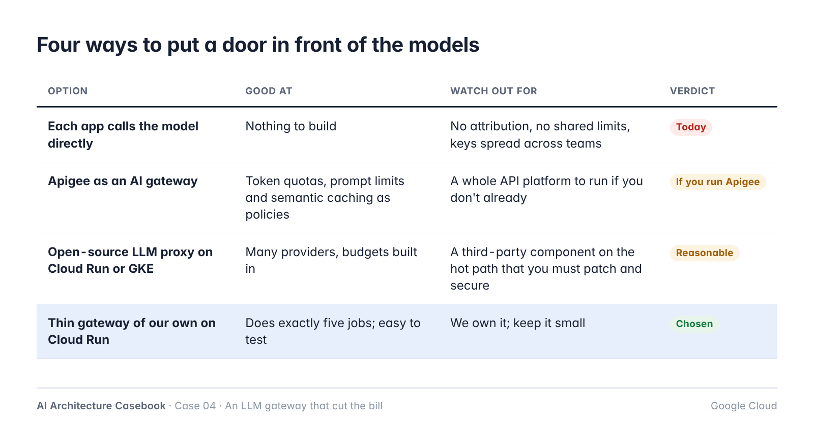

## 5. Use-case policy (example)

```yaml
claims-summary:
  owner: claims-team
  callers: [claims-portal-sa]
  tier: flash
  max_output_tokens: 800
  budget_usd_per_day: 120
  on_budget: alert          # interactive
  exact_cache: false
  max_retries: 2
nightly-enrichment:
  owner: data-team
  callers: [enrichment-job-sa]
  tier: flash-lite
  mode: batch
  budget_usd_per_day: 60
  on_budget: stop
```

Tier map (pinned): `flash-lite → <model id@version>`, `flash → …`, `pro → …`. Changing the map is a release (Case 05).

## 6. Usage record

```
time, caller, use_case, owner_team, model, mode (online|batch),
input_tokens, cached_tokens, output_tokens, latency_ms, status,
retry_of, cache_layer (none|prefix|exact|semantic), cost_usd, price_version
```

Monthly reconcile: sum of `cost_usd` vs billing export; variance tracked.

## 7. Findings (two weeks of metering, scaled to a month)

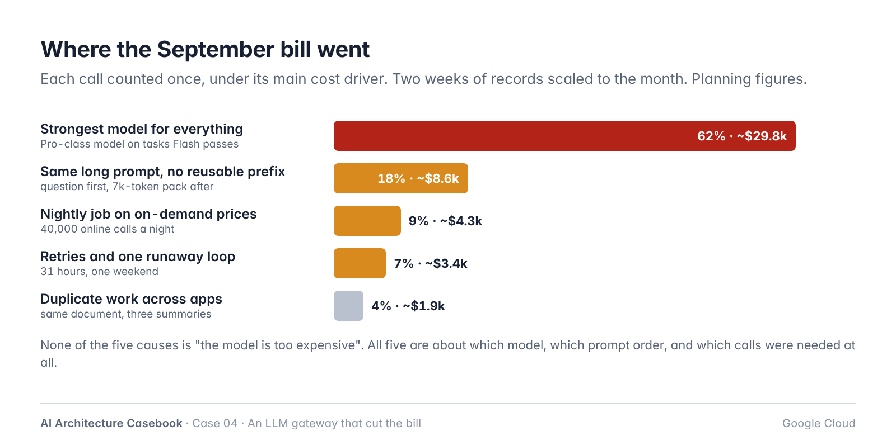

| Cause | Share | Fix |
|---|---|---|
| Pro-class model on tasks a Flash-class model passes | 62% | Tier per use case (ADR-003) |
| Long prompt with variable part first | 18% | Prompt order rule, prefix caching (ADR-004) |
| Nightly job on online API | 9% | Batch inference (ADR-004) |
| Retries and a 31-hour runaway loop | 7% | Retry budget, circuit breaker, hard budgets (ADR-005) |
| Duplicate summaries across apps | 4% | Exact-response cache with data version (ADR-004) |

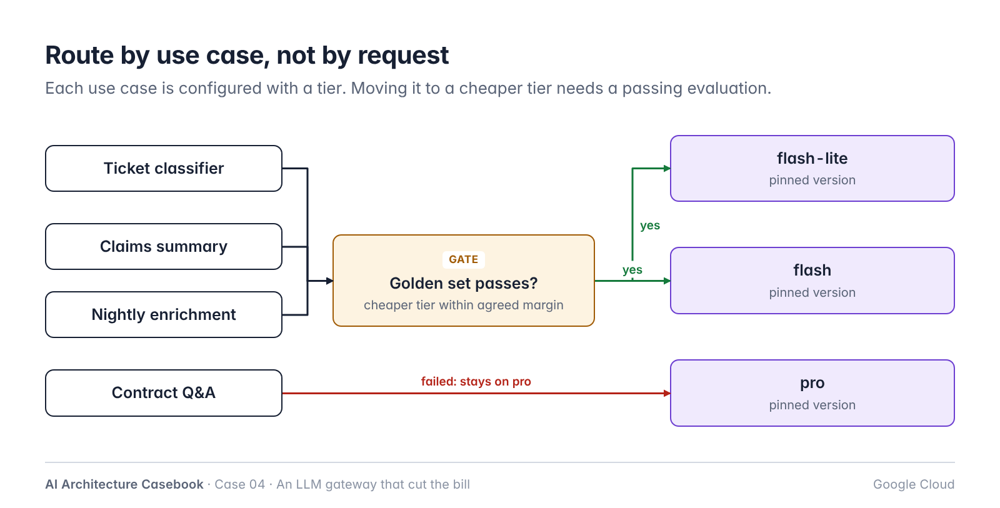
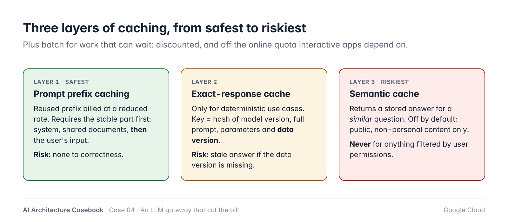
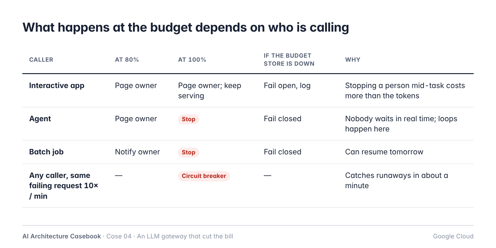

## 8. Planning numbers

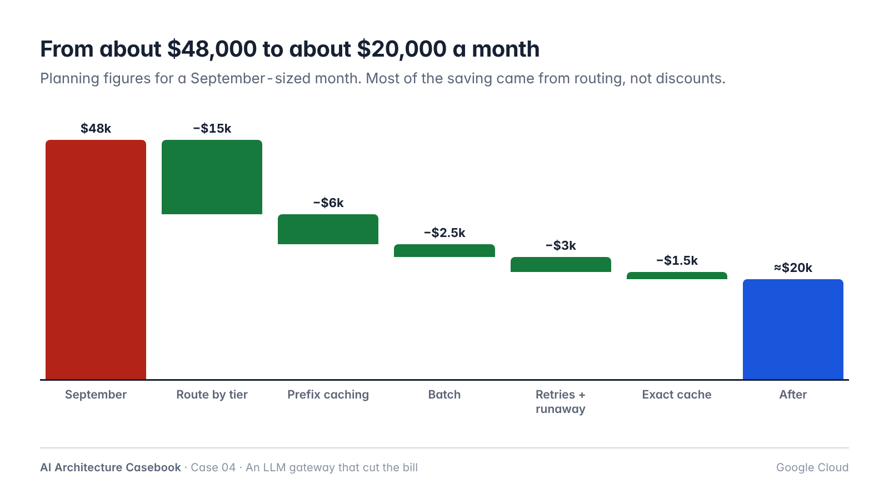

| | Before | After |
|---|---|---|
| Monthly spend | ~$48k | ~$20k |
| Calls attributed to a use case | ~0% | 100% |
| Use cases on Pro tier | 9 | 2 |
| Runaway detection | invoice, weeks later | circuit breaker, ~1 minute |

## 9. Risks

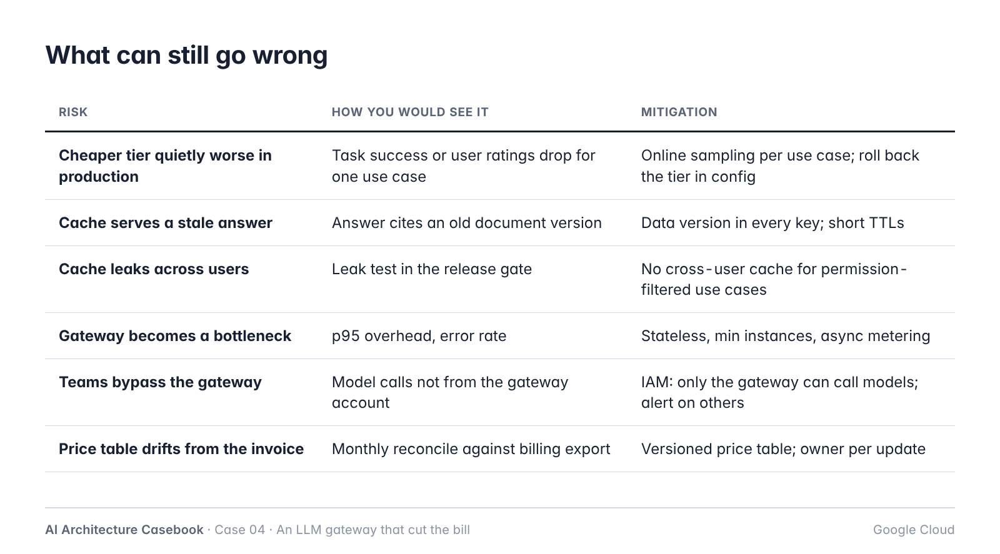

| Risk | Detection | Mitigation |
|---|---|---|
| Cheaper tier quietly worse | Task success / ratings per use case | Online sampling; roll back tier in config |
| Stale cached answer | Old document version cited | Data version in cache key; short TTL |
| Cross-user cache leak | Leak test in release gate | No cross-user cache for permission-filtered use cases |
| Gateway bottleneck or outage | p95 overhead, error rate | Stateless, min instances, async metering |
| Teams bypass the gateway | Model calls from other principals | IAM; alert on any other caller |
| Price table drift | Monthly reconcile | Versioned table with an owner |

## 10. Evaluation

- Per use case: golden set (20–60 real requests with expected outputs) run against current and candidate tier; promote if within agreed margin.
- Gateway: load test for overhead; leak test (two users, different access, same question) must return different answers or no cache hit.
- Metering: sum of usage records within 3% of billing export (planning target).

## 11. At 10x

- Policy file needs an owner and review process.
- Provisioned throughput priced for the steadiest interactive use cases.
- Agent-heavy traffic: evaluate Agent Platform's Agent Gateway for agent-to-tool traffic; this gateway stays for agent-to-model calls.

## 12. Open questions

- Agreed quality margin per use case for tier changes (business owner decides).
- Whether to allow any semantic cache at all (only the internal FAQ is a candidate).
- Chargeback vs showback: does finance bill teams, or only report?
- Which use cases justify provisioned throughput.
