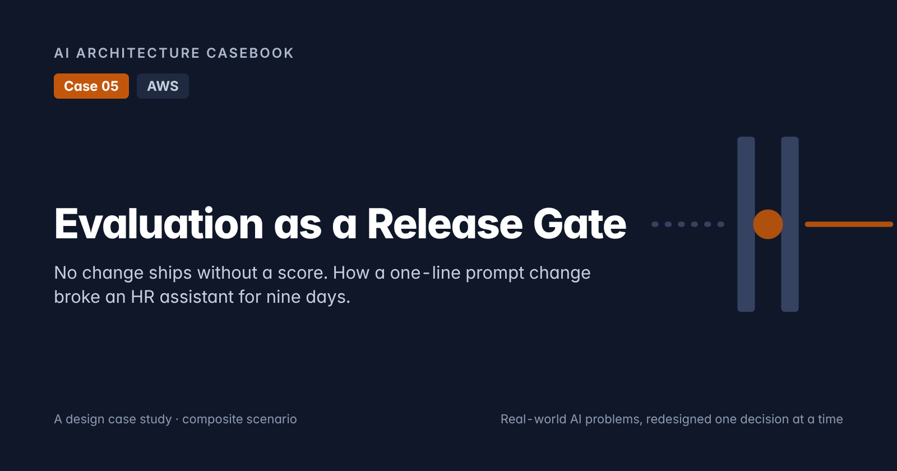
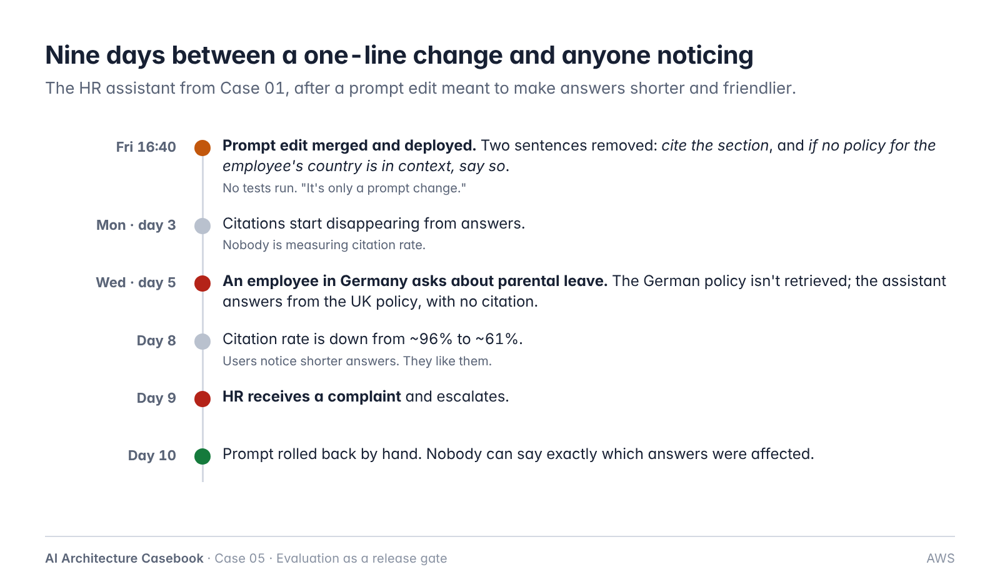
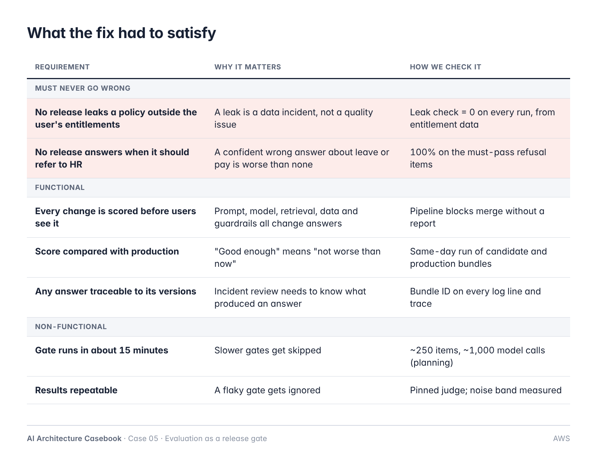
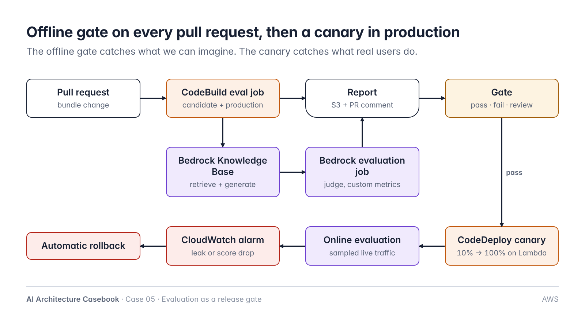
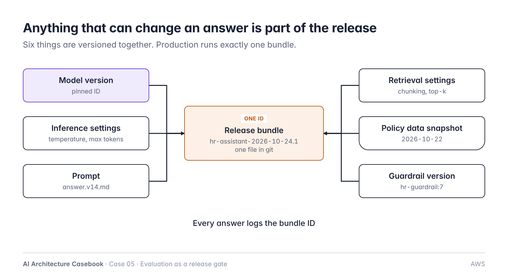
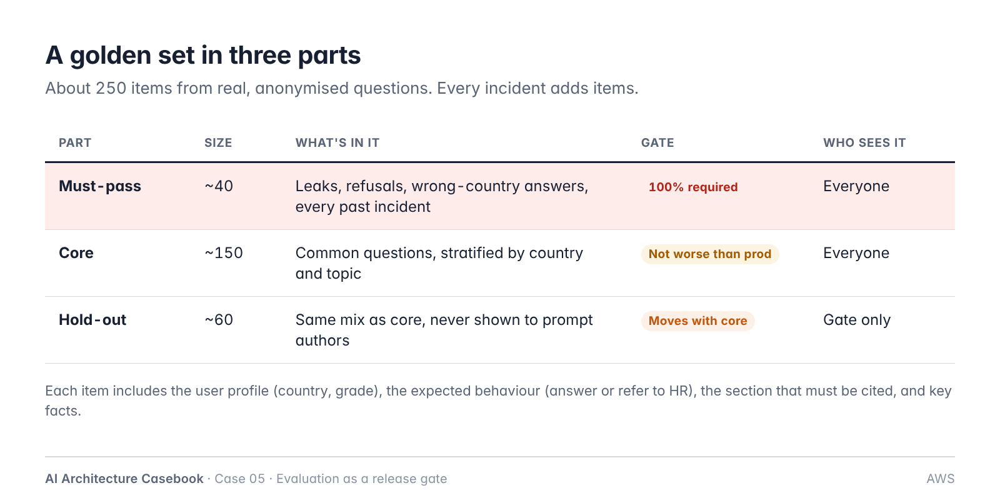
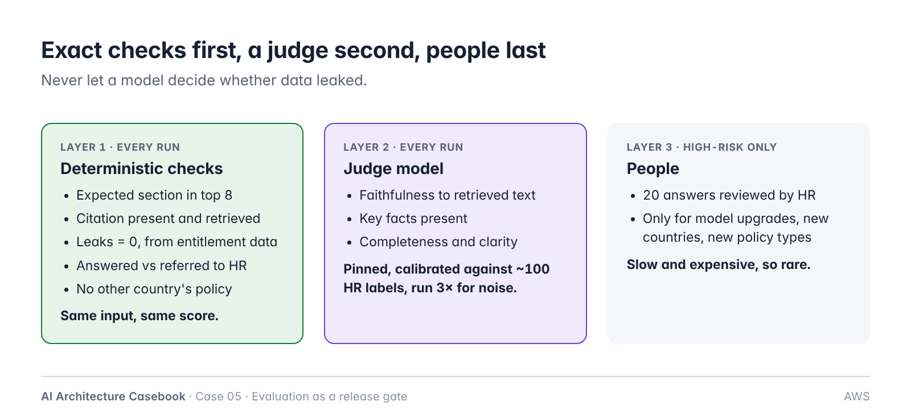
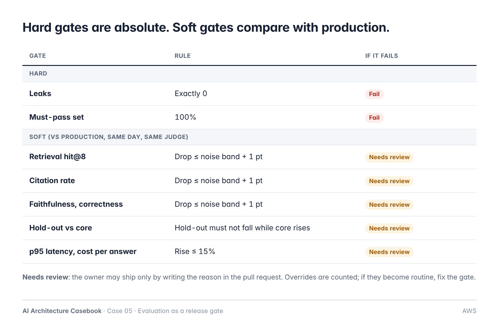
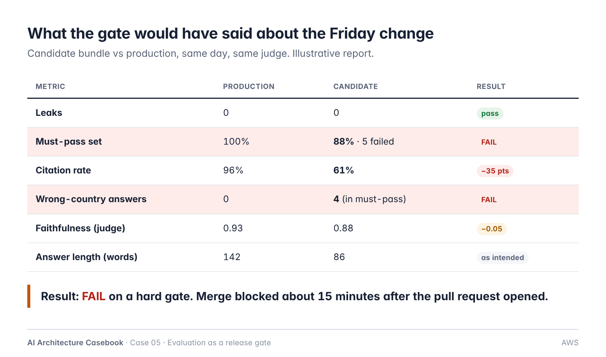
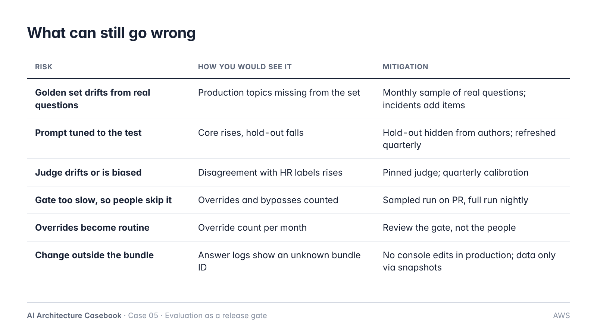

# Case 05: Evaluation as a Release Gate

**Cloud:** AWS · **Status:** Design (ADRs proposed), post ready · **Blog post:** *Evaluation as a Release Gate: No Change Ships Without a Score* (`post.md`)

> Composite scenario on synthetic data. Numbers are planning figures, not benchmark results.
> Builds on Case 01 (permission-aware HR assistant; leaks decided by entitlement data) and the deterministic-vs-judge split from the Labs notes. Case 02 and Case 04 point here for tier and threshold changes.



## 1. Problem

The Case 01 HR assistant changed six times in six weeks: model version, chunk size, a new policy batch, three prompt edits. None was tested repeatably. A prompt edit to make answers "shorter and friendlier" removed two sentences (cite the section; refer to HR if no policy for the employee's country is in context). Over nine days citation rate fell from ~96% to ~61%, and an employee in Germany received the UK parental-leave rules. Found only through an HR complaint; affected answers could not be identified.

**Core problem:** prompt, model, retrieval, data and guardrail changes are releases, but were treated as configuration. Nothing scored a change against the version it replaced.



## 2. Requirements



**Must never go wrong**
- No release leaks a policy outside the user's entitlements (leaks = 0, checked from entitlement data).
- No release answers where it must refer to HR (100% on must-pass refusal items).

**Functional**
- Every behaviour change is scored before users see it, against production on the same day.
- Every answer traceable to the bundle that produced it.
- Owner can override a soft-gate failure only with a written reason.

**Non-functional**
- Offline gate in ~15 minutes (~250 items, ~1,000 model calls).
- Repeatable: pinned judge, measured noise band.

**Out of scope:** the assistant's retrieval design (Case 01); general model benchmarking.

## 3. Architecture



```
PR (bundle change) ──► CodeBuild eval job
                         ├─ run golden set: candidate bundle + production bundle (Bedrock KB retrieve + generate)
                         ├─ layer 1: deterministic checks (code)
                         ├─ layer 2: judge (Bedrock evaluation job or own harness, pinned judge)
                         └─ report → S3 + PR comment → gate: pass | fail | needs_review
merge ──► CodeDeploy (Lambda, canary 10%) ──► online evaluation on sampled traffic
                                               └─ CloudWatch alarm (leak or score drop) ──► automatic rollback
```

| Component | AWS service | Responsibility |
|---|---|---|
| Bundle repo | Git (CodeCommit/GitHub) | Release bundle manifest, prompts, golden set |
| Eval job | CodeBuild | Run golden set for candidate and production; score; report |
| Assistant runtime | Lambda + Bedrock Knowledge Bases | Retrieve + generate with a given bundle |
| Judge | Amazon Bedrock evaluation jobs (RAG evaluation, LLM-as-judge, custom metrics) or own harness | Faithfulness, correctness, completeness |
| Reports | S3 | Per-run results, per-item detail |
| Deployment | CodeDeploy (Lambda canary) | 10% → 100%; alarm-based rollback |
| Online evaluation | Sampler Lambda (or AgentCore Evaluations online, if hosted on AgentCore) | Score sampled live conversations with the same checks |
| Alarms | CloudWatch | Leak > 0, online score below baseline |

## 4. Key decisions

| ADR | Decision |
|---|---|
| [ADR-001](adr/ADR-001-release-bundle.md) | Version model, inference, prompt, retrieval, data snapshot and guardrail as one release bundle |
| [ADR-002](adr/ADR-002-golden-set-three-parts.md) | Golden set in three parts (must-pass, core, hidden hold-out); incidents add items |
| [ADR-003](adr/ADR-003-deterministic-first-judge-second.md) | Deterministic checks first; pinned, calibrated judge only for judgement |
| [ADR-004](adr/ADR-004-gate-on-baseline.md) | Hard gates absolute; soft gates relative to production with a measured noise band |
| [ADR-005](adr/ADR-005-canary-with-online-evaluation.md) | Canary with online evaluation and automatic rollback |



## 5. Release bundle

```yaml
bundle: hr-assistant-2026-10-24.1
model: <bedrock model id, pinned>
inference: {temperature: 0.2, max_tokens: 700}
prompt: prompts/answer.v14.md
retrieval: {knowledge_base: hr-policies, data_snapshot: 2026-10-22, chunking: section-v3, top_k: 8}
guardrail: hr-guardrail:7
```

## 6. Golden set



```yaml
id: GS-0412
question: "How much parental leave do I get?"
user: {country: DE, grade: L4}
expect:
  behaviour: answer          # or: refuse
  section: DE-PAR-2.1
  facts: ["20 weeks at full pay"]   # synthetic policy
  must_not_cite_country: [UK, US]
```

## 7. Scoring and gate





Reference sketch: see `post.md` ("A sketch of the gate").

## 8. Planning numbers

| | Before | After |
|---|---|---|
| Time from bad change to detection | 9 days (complaint) | ~15 minutes (PR) |
| Changes scored before release | 0 of 6 | all |
| Answers traceable to versions | no | bundle ID on every answer |
| Gate run | — | ~250 items, ~1,000 model calls, ~15 min |

## 9. Risks



| Risk | Detection | Mitigation |
|---|---|---|
| Golden set drifts from real questions | Topic coverage report | Monthly sampling; incidents add items |
| Overfitting to the test | Core up, hold-out down | Hidden hold-out; quarterly refresh |
| Judge drift or bias | Agreement with HR labels | Pinned judge; quarterly calibration |
| Gate skipped because slow | Override and bypass counts | Sampled run on PR; full run nightly |
| Change outside the bundle | Unknown bundle ID in logs | No console edits; data via snapshots |

## 10. Evaluation of the gate itself

- Catch rate: share of production incidents the gate would have caught (replay each incident's bundle).
- False-fail rate: gate failures overturned on review.
- Noise band per metric: three judge runs on the production bundle, weekly.

## 11. At 10x

- Harness and judge become a shared platform service.
- Sampled golden set on PR, full set nightly and before production.
- Judge cost and drift become a tracked line item.

## 12. Open questions

- Tolerance per soft metric (HR and engineering agree).
- Who owns the must-pass set (proposed: HR policy owners).
- Retention of evaluation transcripts (they contain synthetic but realistic HR questions).
