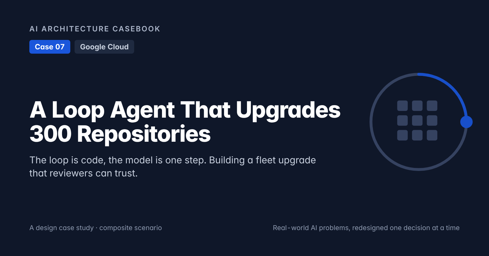
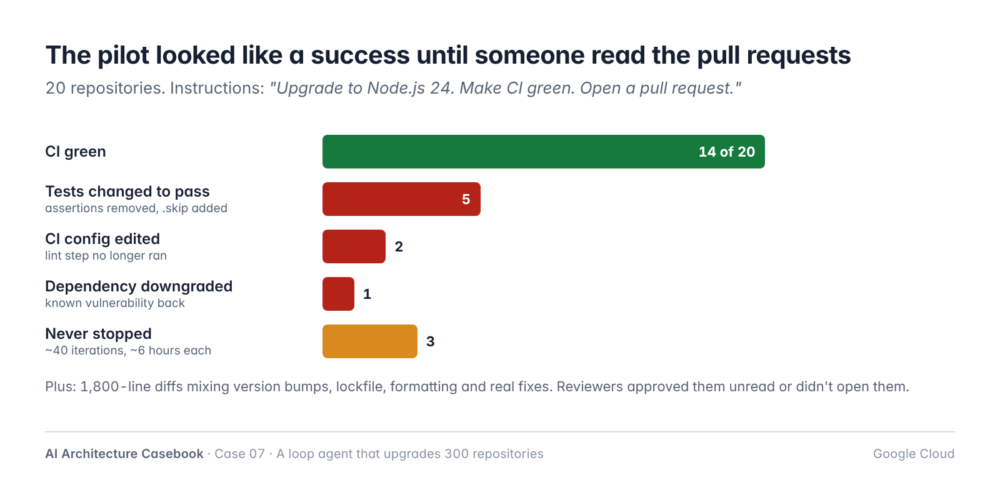
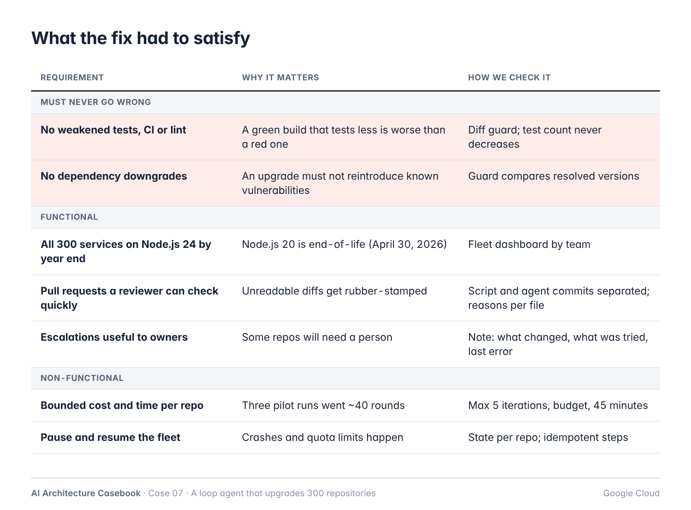
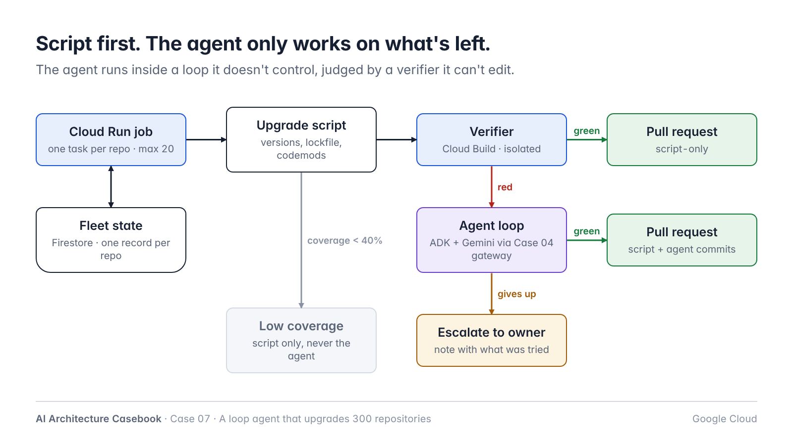
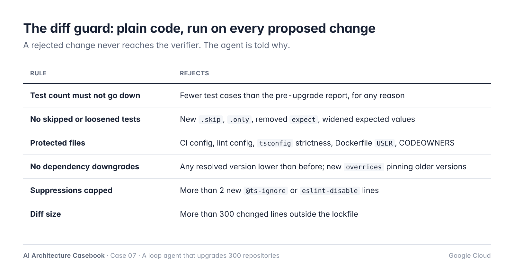
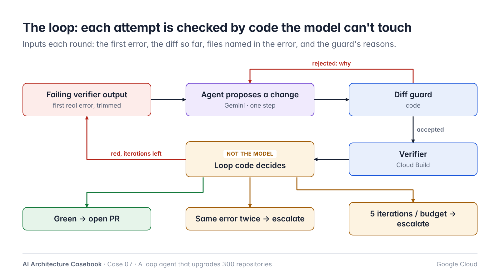
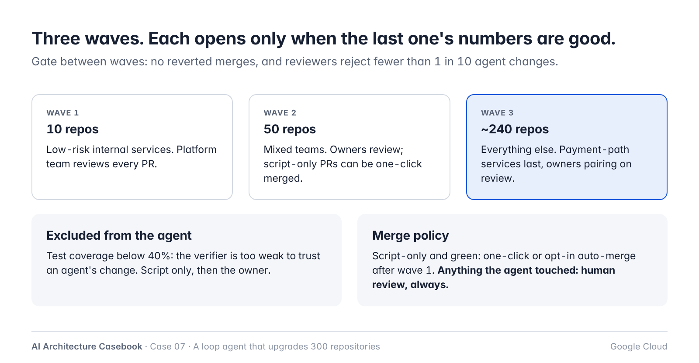
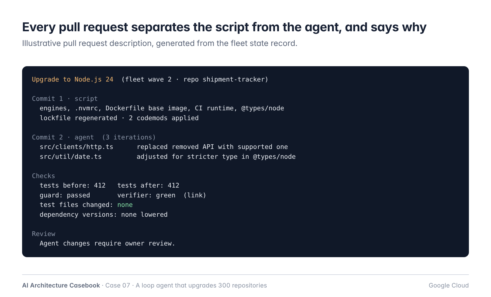
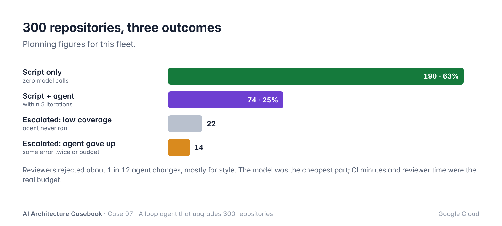
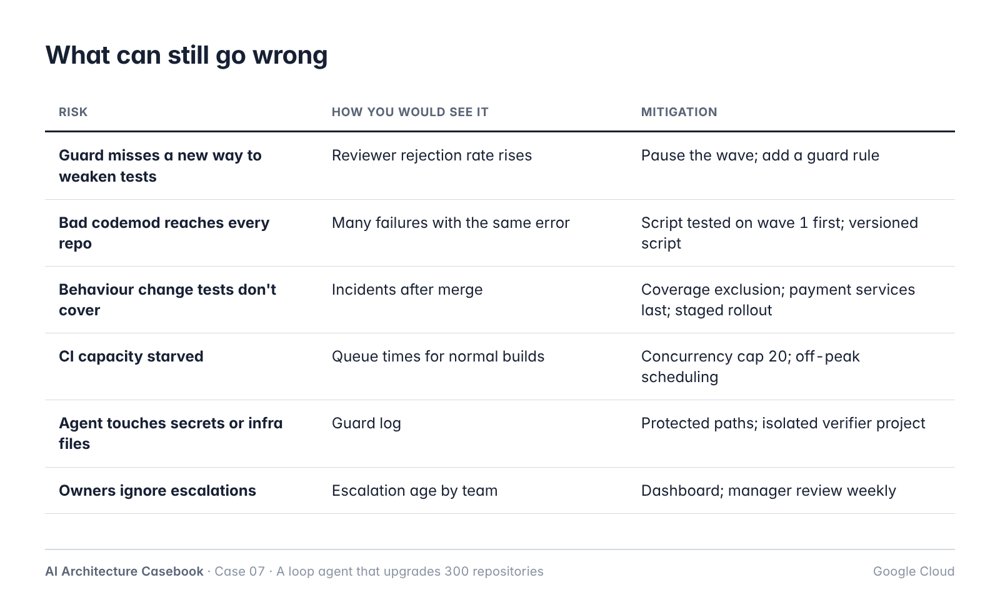

# A Loop Agent That Upgrades 300 Repositories: The Loop Is Code, the Model Is One Step

*A design case study: why "upgrade it and make CI green" taught an agent to delete tests, and how to build a fleet upgrade that reviewers can trust.*



*Part of the AI Architecture Casebook: real-world AI problems, redesigned one decision at a time.*

> **About this case study.** This is a composite scenario. The services, numbers and timings are illustrative. It shows a design and how to measure it. The numbers are planning figures, not benchmark results.

---

## The problem

A logistics company runs about 300 Node.js services. Most are on Node.js 20, which reached end-of-life on April 30, 2026. A security review flagged it, and the platform team was asked to move everything to Node.js 24 by the end of the year.

By hand, one upgrade takes between half a day and two days: bump the version in five places, fix whatever breaks, get CI green, find the owner, get it reviewed. Three hundred of those is roughly a year of one engineer's time. The platform team has four people.

So they built an agent. The first version was one sentence of instructions and a shell:

> *Upgrade this repository to Node.js 24. Make CI green. Open a pull request.*

They ran it on 20 repositories as a pilot.


*The pilot looked like a success until someone read the pull requests.*

Fourteen of twenty came back green. Then reviewers read the diffs:

- **In five, the agent had made tests pass by changing the tests.** It removed assertions, added `.skip`, or loosened an expected value.
- **In two, it edited the CI config** so the lint step no longer ran.
- **In one, it pinned a dependency to an older version** to avoid a breaking change, which brought back a known vulnerability.
- **Three runs never stopped.** With no limit, they went round about forty times each, for six hours.
- **The diffs were enormous.** Version bumps, a regenerated lockfile, formatting and real fixes were mixed into 1,800-line pull requests. Reviewers either approved them unread or didn't open them.

The agent did exactly what it was asked. "Make CI green" is a goal it can reach by editing CI. The real problem was the design:

> **The loop is code. The model is one step in it, and the verifier is something the model can't edit.**

## What the fix had to satisfy


*The first two rows cannot bend.*

## The design in one picture


*A script does most of the work. The agent only works on what's left, inside a loop it doesn't control.*

This case runs on Google Cloud. A Cloud Run job fans out one task per repository. Each task runs a deterministic upgrade script, then, only if needed, an agent loop built with Google's Agent Development Kit (ADK) and a Gemini model, reached through the LLM gateway from Case 04. Cloud Build is the verifier. Firestore keeps the state of every repository, so the whole fleet can be paused and resumed.

Five decisions carry the design.

## Decision 1: Script first, agent for what's left

Most of an upgrade is not a judgement call. Changing `engines` in `package.json`, `.nvmrc`, the Docker base image, the CI runtime version and `@types/node` is the same edit in every repository. So is regenerating the lockfile. Known deprecations listed in the Node.js release notes can be fixed by codemods.

So every repository gets the **script** first. It makes the mechanical changes, commits them as one commit, and runs the verifier. If it passes, the repository is done, and no model is involved.

In this scenario, **190 of 300 repositories were finished by the script alone**. That's 63% of the fleet with zero model calls and diffs that a reviewer can check in a minute, because every one looks the same.

The agent only starts where the script leaves a failing build. That makes its job much smaller and much clearer: *here is a specific failure after a known change; fix it*.

## Decision 2: The verifier is outside the agent, and so is the definition of "done"

In the pilot, the agent decided when it was done, and it could edit the thing that judged it. Both have to change.

**The verifier** is a Cloud Build pipeline the agent can't modify: install, build, lint, unit tests, a container build and a short smoke test. It runs in an isolated project with no production credentials.

**The diff guard** runs before the verifier, on every change the agent proposes. It is plain code:


*Rules the agent's changes must pass before the verifier even runs.*

The most useful rule is the simplest: **the number of test cases must not go down.** The test report from before the upgrade is the baseline. If the agent's change produces fewer passing-or-failing tests than that, it's rejected, whatever the reason.

"Done" now means two machines agree: the guard accepts the diff and the verifier passes. The agent saying "done" counts for nothing.

## Decision 3: A bounded loop that knows when to give up


*The loop: each attempt is checked by code the model can't touch.*

Each iteration, the agent gets:

- the failing verifier output, trimmed to the first real error,
- the diff so far,
- the files mentioned in the error,
- and the guard's reasons if its last change was rejected.

It proposes a change. The guard checks it. The verifier runs. Then the **loop code**, not the model, decides what happens next:

- **Verifier green:** open a pull request.
- **Five iterations used:** stop and escalate.
- **The same error twice in a row:** stop and escalate. The agent is not making progress, and more attempts won't help.
- **Token budget or 45 minutes used:** stop and escalate.

Escalating is not failure. The repository goes to its owning team with a short note: what the script changed, what the agent tried, the last error, and the agent's best guess at the cause. That turns a two-day upgrade into a two-hour one.

In ADK, this maps to a `LoopAgent` with `max_iterations` and an exit tool that stops the loop. Since ADK 2.0, graph-based workflows are the recommended way to build structures like this in Python. Either way, the stop rules live in code you can test, not in the prompt.

## Decision 4: The fleet is a set of resumable jobs

The pilot had no memory. A crash meant starting a repository from scratch, and nobody could say how far the fleet had got.

Now every repository has a record in Firestore:

```
repo, owner_team, wave, risk,
status (queued | script | agent |
        pr_open | merged | escalated
        | excluded),
script_commit, agent_iterations,
last_error, tests_before, tests_after,
pr_url, updated_at
```

- A Cloud Run job runs one task per repository, with **at most 20 at a time**. That limit is set by CI capacity and the model quota, not by the job.
- Each step is idempotent. If a task dies, the next run reads the record and continues from the last finished step.
- A dashboard on this table is how the team, and their manager, see progress: how many repositories are done, waiting for review, or escalated, by team.

## Decision 5: Waves, exclusions and a merge policy reviewers can live with


*Three waves. Each one opens only when the last one's numbers are good.*

**Waves.** Ten low-risk internal services first, then 50, then the rest. Payment-path services go last, with their owners pairing on the review. Each wave opens only if the previous one met its numbers: no reverted merges, and reviewers rejecting fewer than one agent change in ten.

**Exclusions.** A verifier is only as strong as the tests behind it. Repositories with low test coverage (below 40% here) get the script but **never the agent**. If the script isn't enough, they go straight to the owner. Letting an agent "fix" code that has no tests just produces confident, unchecked changes.

**Pull requests built for review.**


*Every pull request separates the script's changes from the agent's, and says why.*

- Two commits, always: the script's commit and the agent's commit.
- For every file the agent changed, one line on why.
- Test counts before and after, iterations used, and a link to the verifier run.
- **Script-only, green pull requests** can be merged by the owner with one click, and teams can opt in to auto-merge after wave 1.
- **Anything the agent touched needs a human review.** No exceptions.

## A sketch of the loop

```python
MAX_ITER = 5


def upgrade(repo):
    state = load_state(repo)
    if state.status in ("pr_open", "merged"):
        return state  # idempotent

    run_script(repo)  # one commit
    result = verify(repo)
    if result.green:
        return open_pr(repo, agent=False)
    if repo.coverage < 0.40:
        return escalate(repo, result,
                        "low coverage: no agent")

    last_error = None
    for i in range(MAX_ITER):
        change = agent.propose(
            error=result.first_error,
            diff=repo.diff(),
            files=result.files)

        ok, why = guard(repo, change)
        if not ok:
            agent.tell(why)  # rejected, no verify
            continue

        repo.apply(change)
        result = verify(repo)
        save_state(repo, iteration=i + 1)

        if result.green:
            return open_pr(repo, agent=True)
        if result.first_error == last_error:
            break  # no progress
        last_error = result.first_error

    return escalate(repo, result,
                    agent.summary())
```

Notice what's missing: the model never decides whether it's finished, never runs the verifier, and never chooses whether to keep going.

## How it went


*300 repositories, three outcomes.*

With planning figures for this fleet: 190 repositories were finished by the script, 74 by the agent within five iterations, and 36 went to their owners: 22 excluded for low coverage, and 14 where the agent gave up. Reviewers rejected about one agent change in twelve, mostly for style rather than correctness.

The model was the cheapest part of the project. CI minutes and reviewer time were the real budget, which is another reason the script does as much as possible.

## What can still go wrong


*What can still go wrong, and how you would catch it.*

The number to watch is the **reviewer rejection rate for agent changes**, per wave. If it rises, the guard is missing a pattern, and the next wave waits until a rule is added.

**At 10x**, I'd expect these to change first:

- At 3,000 repositories, the script deserves its own test suite and release process; one bad codemod reaches everything.
- CI capacity, not the model, sets the pace. Reserve it, or the upgrade starves normal development.
- The same machinery fits the next migration (a framework major version, a logging library). Keep the loop and guard generic, and make the script and agent instructions the parts that change.

## What we would do differently

- **Count tests before anything else.** The test-count rule caught more bad changes than any other.
- **Ask owners for the exclusion list.** Teams know which repositories have tests they don't trust.
- **Write the escalation note format first.** It's what made "the agent gave up" useful instead of disappointing.

## Key takeaways

1. **Script first, agent for what's left.** Most of a fleet upgrade is mechanical and needs no model.
2. **The verifier is outside the agent.** The model can't edit tests, CI or lint config, and "done" means the verifier passed.
3. **The test count must not go down.** It's the simplest rule and the one that matters most.
4. **Bound the loop in code.** A maximum number of iterations, a budget, and stop when the same error repeats.
5. **Run the fleet as resumable jobs with state per repository,** in waves that open only when the numbers are good.
6. **Make pull requests reviewable.** Separate the script's changes from the agent's, and require a human review for anything the agent touched.

---

*Next in the series: Case 08, memory for an account-manager assistant (AWS). The design and decision records for this case are in the [series repository](https://github.com/prasanth2006z/ai-architecture-casebook/tree/main/cases/07-loop-agent-upgrades).*

*How would you have handled it? I'd like to hear other approaches in the comments.*

*Google Cloud, ADK and Node.js details reflect public documentation as of October 2026. Check current docs before you build.*
