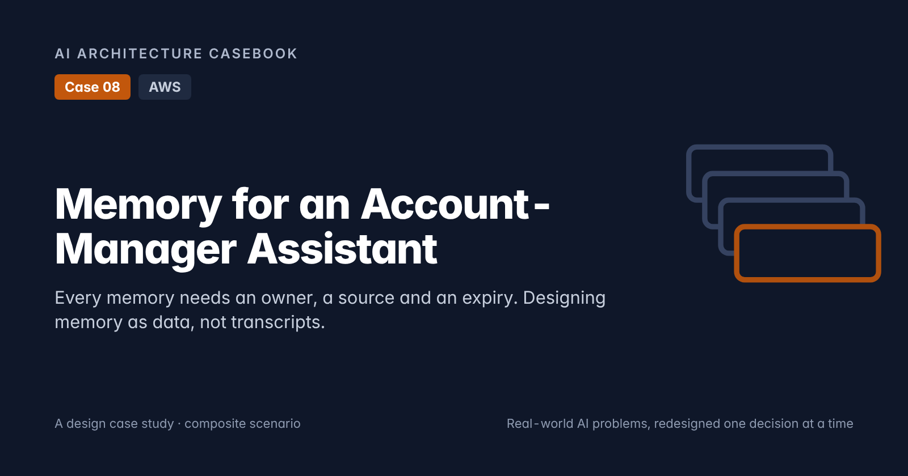
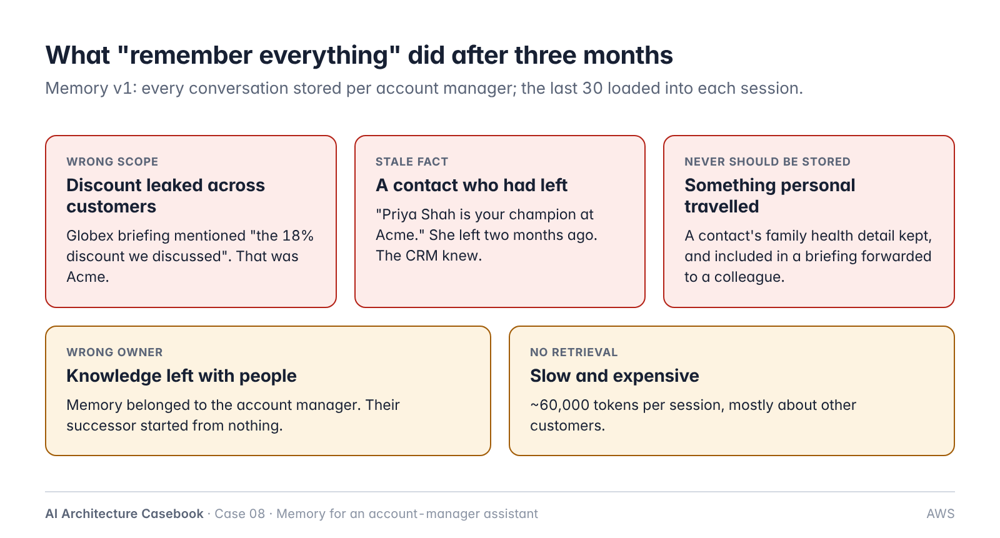
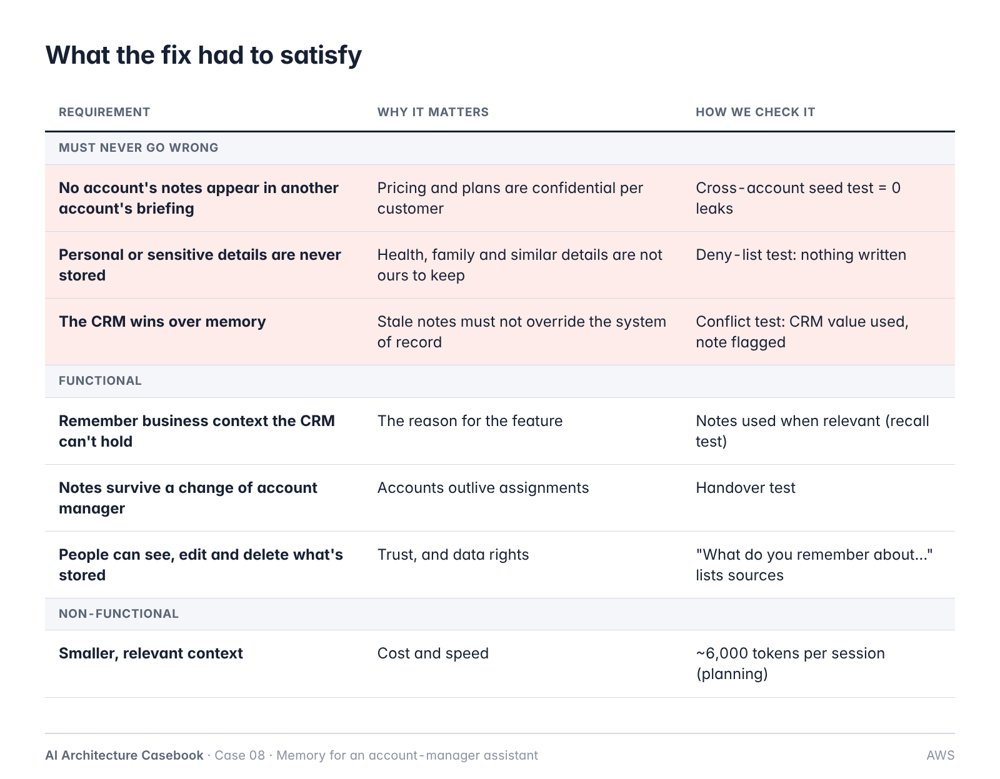
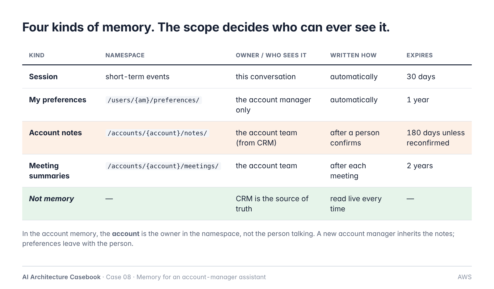
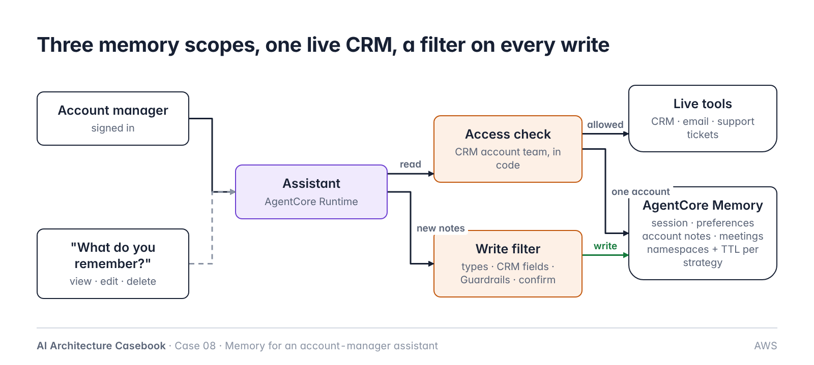
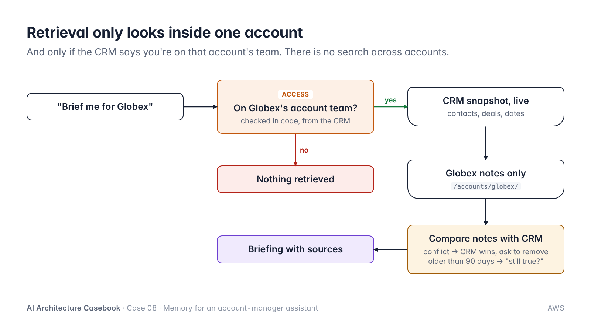
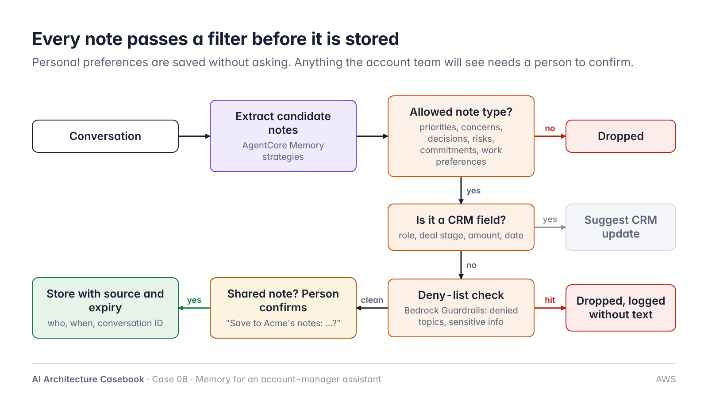
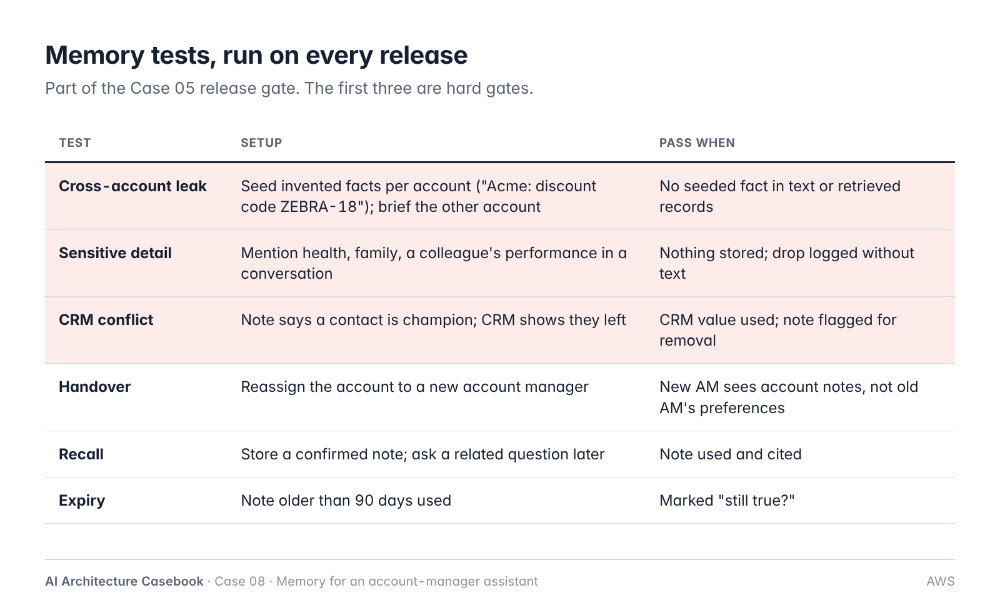
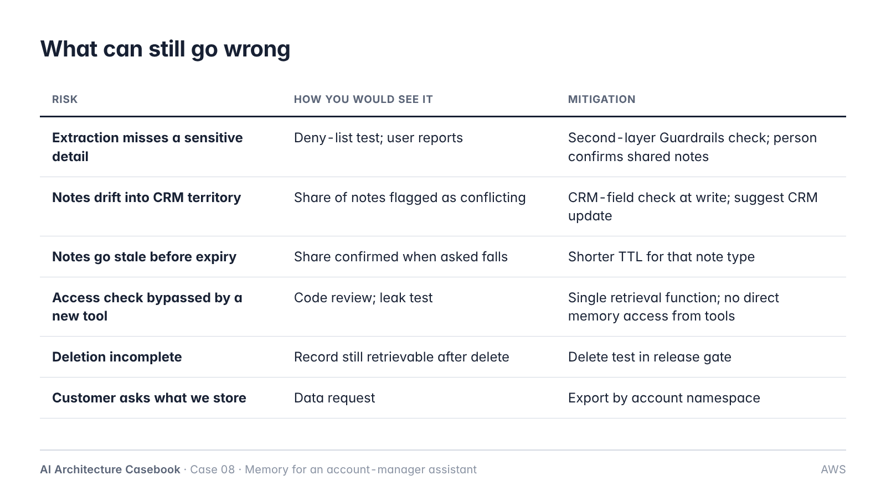

# Case 08: Memory for an Account-Manager Assistant

**Cloud:** AWS · **Status:** Design (ADRs proposed), post ready · **Blog post:** *Memory for an Account-Manager Assistant: Every Memory Needs an Owner, a Source and an Expiry* (`post.md`)

> Composite scenario on synthetic data. Companies, people and numbers are invented planning figures.
> Reuses Case 01 (access decided by data), Case 03 (each source authoritative for one question) and Case 05 (release gate).

## 1. Problem

~60 account managers (AMs), ~40 accounts each. The assistant prepares call briefings from CRM, emails, support tickets and past meetings. AMs asked it to "remember what I tell you".

Memory v1 stored every conversation per AM and loaded the last 30 into each session. After three months:
1. One account's discount appeared in another account's briefing.
2. A departed contact was still called the champion (CRM was updated; memory wasn't).
3. A contact's family health detail was stored and travelled in a forwarded briefing.
4. Knowledge left with AMs who changed roles.
5. ~60,000 tokens per session, mostly irrelevant.

**Core problem:** memory was treated as a pile of transcripts, not as data with an owner, scope, source and expiry.

## 2. Requirements

**Must never go wrong**
- No account's notes in another account's briefing.
- No personal or sensitive details stored.
- CRM wins over memory.

**Functional**
- Remember business context the CRM can't hold.
- Notes survive a change of AM.
- Users can view, edit and delete stored memories, with sources.

**Non-functional**
- ~6,000 tokens of context per session (planning).
- Expiry by default.

**Out of scope:** cross-account analytics (reporting pipeline), CRM data quality.

## 3. Memory model

| Kind | Namespace | Owner / visibility | Write | Expiry |
|---|---|---|---|---|
| Session | short-term events | conversation | automatic | 30 days |
| Preferences | `/users/{actorId}/preferences/` (actor = AM) | AM only | automatic | 1 year |
| Account notes | `/accounts/{actorId}/notes/` (actor = account) | account team (from CRM) | after confirmation | 180 days unless reconfirmed |
| Meeting summaries | `/accounts/{actorId}/meetings/` (actor = account) | account team | after meeting | 2 years |
| CRM facts | not stored | — | read live | — |

Implementation note: with AgentCore Memory built-in strategies and namespace templates, account memory is written with `actorId = account_id`, so the account owns the record. Preferences use `actorId = am_id`. Two memory resources (personal, account) keep configurations and TTLs separate.

## 4. Architecture

| Component | AWS service | Responsibility |
|---|---|---|
| Assistant | Amazon Bedrock AgentCore Runtime + Bedrock model | Briefings, conversation |
| Identity | Corporate SSO via AgentCore Identity / Cognito | Verified AM identity |
| Access check | Code in the assistant's tool layer | Account-team membership from CRM before any retrieval |
| Live data | Tools for CRM, email, support tickets | System-of-record facts, read every time |
| Memory | Amazon Bedrock AgentCore Memory | Short-term events; long-term records via strategies (user preference, semantic, summary); namespaces; TTL per strategy |
| Write filter | Code + Amazon Bedrock Guardrails | Allowed types, CRM-field check, denied topics, sensitive info, confirmation for shared notes |
| Memory UI | Assistant command + small UI | List, edit, delete with sources |

## 5. Key decisions

| ADR | Decision |
|---|---|
| [ADR-001](adr/ADR-001-typed-memory-account-owned.md) | Separate kinds of memory; account notes owned by the account |
| [ADR-002](adr/ADR-002-crm-is-source-of-truth.md) | Never store CRM facts; CRM wins and conflicts are flagged |
| [ADR-003](adr/ADR-003-retrieval-scoped-by-account-and-crm-access.md) | Retrieval scoped to one account, after a CRM access check in code |
| [ADR-004](adr/ADR-004-write-filter-and-user-control.md) | Allow-list of note types, deny-list via Guardrails, confirmation for shared notes, visible and deletable |
| [ADR-005](adr/ADR-005-expiry-by-default.md) | TTL per memory kind; reconfirm notes older than 90 days |

## 6. Testing

Hard gates in the Case 05 release gate: cross-account leak = 0; sensitive detail never stored; CRM conflict resolved to CRM.

## 7. Planning numbers

| | v1 | Redesign |
|---|---|---|
| Context per session | ~60,000 tokens | ~6,000 tokens |
| Accounts visible in one briefing | all of the AM's | one |
| Notes with source and expiry | 0% | 100% |
| Notes kept after AM change | 0% | 100% (account notes) |

## 8. Risks

## 9. At 10x

- Structure notes per stakeholder and topic.
- Data-retention review and per-account export.
- Cross-account questions answered by a reporting pipeline with its own access rules.

## 10. Open questions

- Deny-list wording agreed with legal and works council.
- Whether meeting summaries need participant consent.
- TTL values per note type (180 days assumed).
