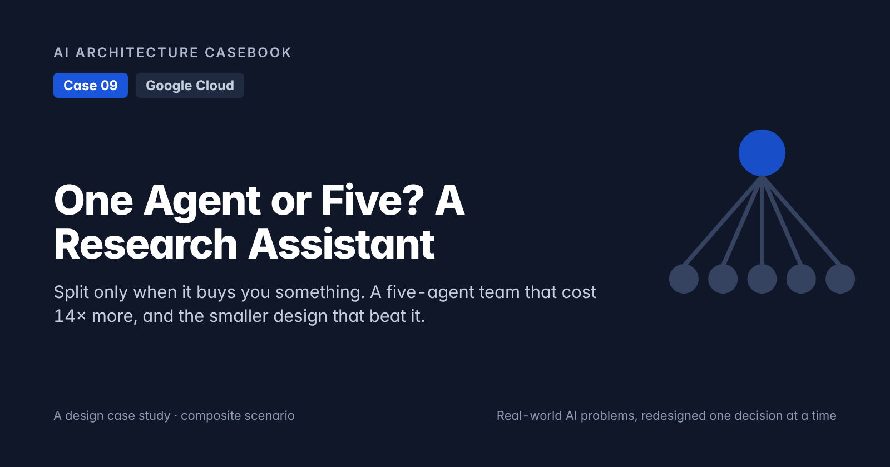
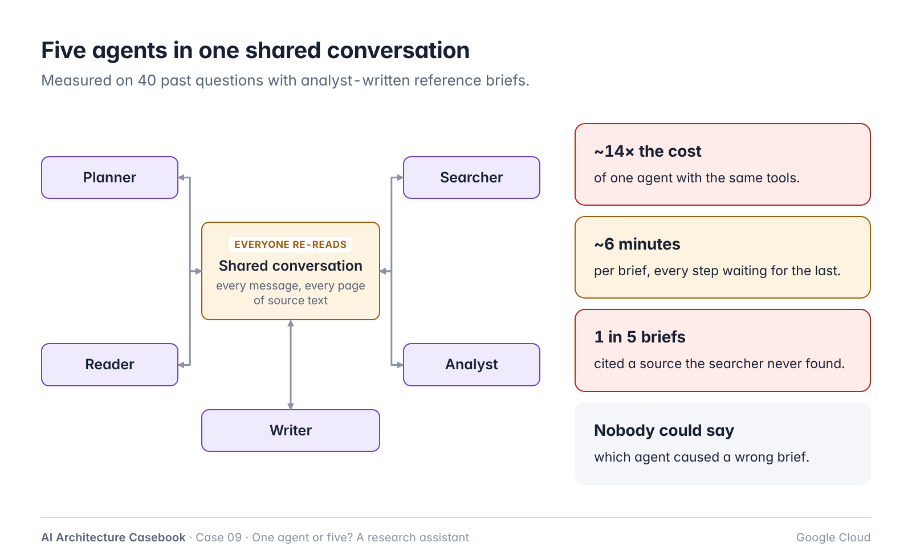
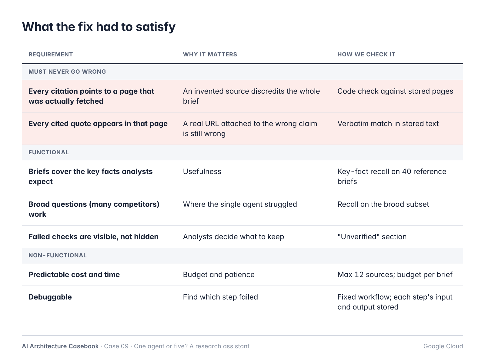
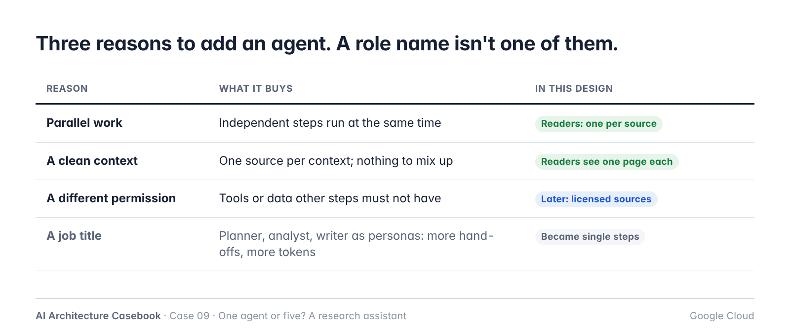
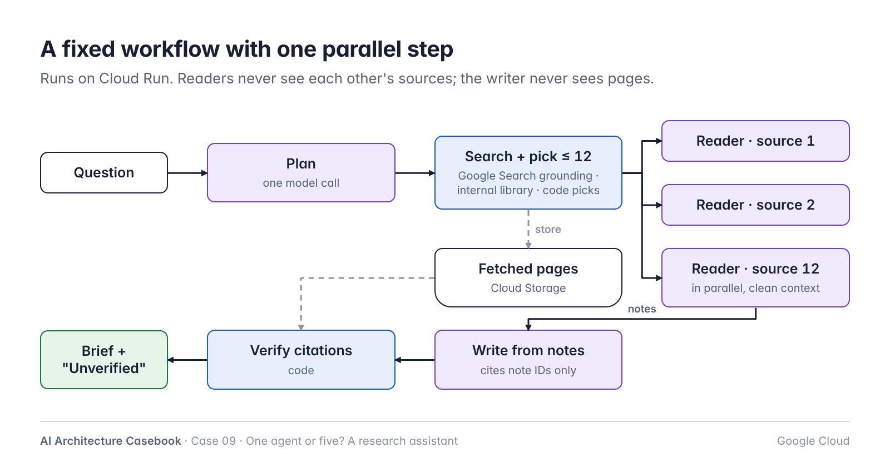
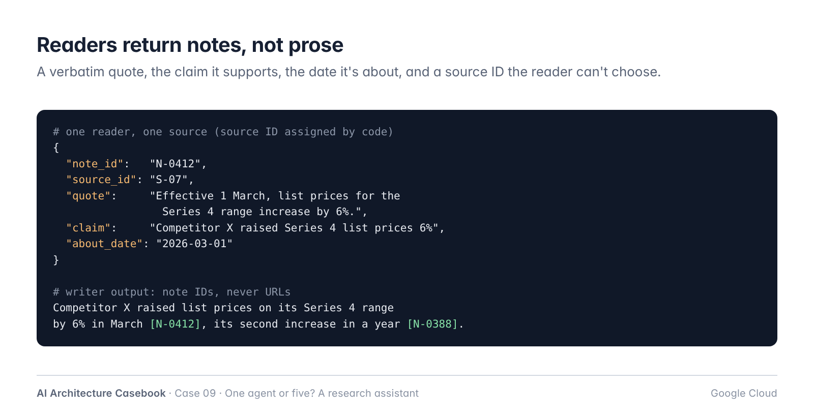
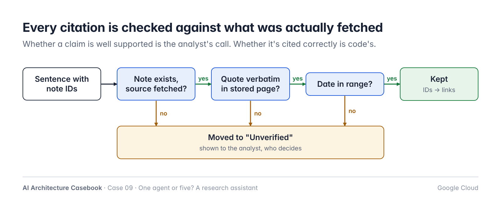
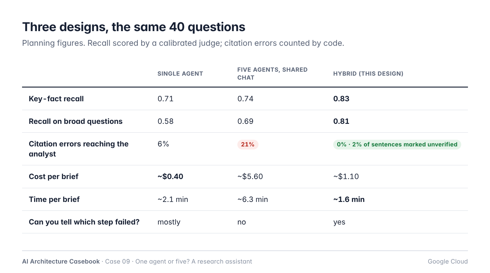
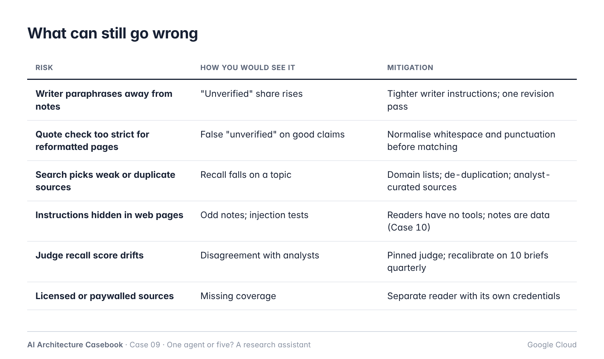

# One Agent or Five? A Research Assistant: Split Only When It Buys You Something

*A design case study: a five-agent research team that cost 14 times more and invented its citations, and the smaller design that beat it.*



*Part of the AI Architecture Casebook: real-world AI problems, redesigned one decision at a time.*

> **About this case study.** This is a composite scenario. The team, questions and numbers are illustrative. It shows a design and how to measure it. The numbers are planning figures, not benchmark results.

---

## The problem

The strategy team at a mid-sized industrial company writes short competitor briefs. A typical request: *"How has Competitor X changed its pricing in the last 12 months? With sources."* By hand, a brief takes an analyst about two days, most of it spent finding and reading sources.

The team built a research assistant. Because research is teamwork, they designed it like a team: **five agents**, each with a role.

- A **planner** breaks the question into sub-questions.
- A **searcher** finds sources.
- A **reader** reads them.
- An **analyst** draws conclusions.
- A **writer** produces the brief.

The agents talked in a shared conversation, so each one could see what the others had said. The demo was impressive. Then the team ran it on 40 real questions from the past year, with briefs the analysts had already written as reference answers.


*Five agents in one shared conversation. Every agent re-reads everything.*

- **It cost about 14 times more** than a single agent with the same tools. Every agent re-read the whole shared conversation, including pages of source text, at every turn.
- **It took about six minutes per brief,** because each step waited for the one before it.
- **One brief in five cited a source the searcher never found.** The writer, working from the analyst's summary of the reader's summary, attached a plausible URL to a real claim. The claim was often true; the citation wasn't.
- **When a brief was wrong, nobody could say which agent caused it.**

The obvious conclusion was "multi-agent is hype; use one agent." So they tried that too. A single agent was faster and much cheaper, and on narrow questions it did well. On broad ones ("compare pricing changes across six competitors") its context filled up with page text, and it missed facts from the sources it read last.

So the answer was neither one nor five:

> **Add an agent only when it buys you something you can measure:** parallel work, a clean context, or a different permission. A job title is not a reason.

## What the fix had to satisfy


*The first two rows cannot bend.*

## Decision 1: Start with one agent, and split only for a measured reason

The five-agent design copied the shape of a human team. People split work into roles because one person can't do everything at once. A model call doesn't have that problem in the same way. Splitting it into personas mostly adds hand-offs, and every hand-off loses information and costs tokens.

There are three good reasons to split work into more than one agent:


*Three reasons to add an agent. A role name isn't one of them.*

1. **Parallel work.** Reading twelve sources one after another is slow. Twelve readers at once is fast.
2. **A clean context.** A reader that sees only one source, and the question, can't mix it up with another source. That's exactly what failed for the single agent on broad questions.
3. **A different permission.** If one step needs access the others shouldn't have, such as internal documents, it belongs in its own agent with its own tools.

Planner, analyst and writer don't meet any of these. Planning and writing are each one model call, and the "analyst" was a second opinion nobody measured. So they became steps, not agents.

## Decision 2: The workflow is code; the agents don't chat

In the five-agent version, the order of work came out of the conversation. Sometimes the analyst asked the searcher for more, sometimes the writer started early. That made it slow, unpredictable and impossible to debug.

Now the order is fixed, in code:


*A fixed workflow with one parallel step. Readers never see each other's sources.*

1. **Plan.** One model call turns the question into a short list of sub-questions and search queries.
2. **Search.** Grounding with Google Search on Google's Gemini Enterprise Agent Platform (formerly Vertex AI), plus the team's internal research library. Code picks at most 12 sources, removes duplicates and applies a domain block-list.
3. **Read, in parallel.** One reader per source, each with a clean context: the question, the sub-questions, and that one page.
4. **Write.** One model call writes the brief from the readers' notes, never from the pages.
5. **Verify.** Code checks every citation (Decision 4).

This runs on Cloud Run. With Google's Agent Development Kit (ADK), it maps to a sequential workflow with a parallel step for the readers, or to a graph workflow in ADK 2.0. Either way, the order and the limits are code: at most 12 sources, one revision at most, and a token budget per brief.

## Decision 3: Readers return notes, not prose

The citation failures came from summaries of summaries. By the time a claim reached the writer, its connection to a source was a sentence someone had paraphrased twice.

So readers don't write prose. They return **notes** in a fixed structure:


*A reader's output: claims tied to a verbatim quote from one fetched page.*

Each note carries a verbatim **quote** from the page, the **claim** it supports, the **date** the claim is about, and the **source ID** of the page the reader was given. The reader can't choose a source ID; code assigns it before the reader starts.

The writer sees only notes, and it must cite **note IDs**, not URLs. Code turns note IDs into links after writing. The writer never types a URL, so it can't invent one.

A reader also has no tools. It reads one page and returns notes. That matters for safety: a web page can contain instructions aimed at the model, and a reader with no tools has nothing to misuse. I'll cover that problem in depth in a later post.

## Decision 4: Citations are checked by code

Even with notes, a writer can attach the wrong note to a claim. So before anyone sees the brief, code checks every citation:


*Every citation is checked against what was actually fetched.*

- **The note exists,** and its source was actually fetched in this run.
- **The quote appears verbatim** in the stored page text. Each fetched page is saved to Cloud Storage at fetch time, so the check is against what the reader saw, not the live page.
- **The date is in range.** A claim about pricing "in the last 12 months" can't rest on a page from three years ago.

A sentence that fails is not silently dropped. It moves to a short **"Unverified"** section at the end of the brief, so the analyst can decide. The judgement of whether a claim is *well supported* still belongs to the analyst; whether it is *cited correctly* is a question code can answer exactly.

## A sketch of the workflow

```python
MAX_SOURCES = 12


async def brief(question):
    plan = await planner(question)
    sources = pick_sources(
        await search(plan.queries),
        limit=MAX_SOURCES)  # code decides

    pages = {s.id: await fetch_and_store(s)
             for s in sources}

    # One reader per source, in parallel,
    # each with a clean context.
    notes = flatten(await gather(*[
        reader(question, plan, pages[sid], sid)
        for sid in pages]))

    draft = await writer(question, notes)
    return verify(draft, notes, pages)


def verify(draft, notes, pages):
    by_id = {n.id: n for n in notes}
    ok, unverified = [], []
    for sentence in draft.sentences:
        good = sentence.note_ids and all(
            nid in by_id
            and by_id[nid].quote
                in pages[by_id[nid].source_id].text
            and in_range(by_id[nid].date)
            for nid in sentence.note_ids)
        (ok if good else unverified).append(sentence)
    return render(ok, unverified, by_id)
```

Notice what's missing: no agent decides what happens next, and no line trusts the writer's citations without checking them against the stored pages.

## Decision 5: Choose the architecture with a task set, not a diagram

The most useful thing the team built was not an agent. It was the set of 40 past questions with reference briefs. With it, each design could be measured on the same questions:


*Three designs on the same 40 questions. Planning figures.*

- **Key-fact recall:** how many of the facts in the reference brief appear in the new one. A judge model compares them, calibrated against analysts' scoring on 10 briefs.
- **Citation errors:** counted by code, as in Decision 4.
- **Cost and time per brief.**

The hybrid design isn't the cheapest. The single agent is. But it has the best recall, no unverified citations reach the analyst unmarked, and it's the fastest, because reading happens in parallel. That's a trade-off you can only make with numbers in front of you. The same comparison will be run again whenever a new model or a new framework feature arrives, because the right answer may change.

## What can still go wrong


*What can still go wrong, and how you would catch it.*

The number to watch is the **share of sentences moved to "Unverified"**. A sudden rise means the writer has started paraphrasing too far from its notes, or a source type has changed shape. Both are worth a look before analysts lose trust.

**At 10x**, I'd expect these to change first:

- With hundreds of briefs a week, fetched pages become a shared, de-duplicated store with a retention policy.
- Some sources will need licences or logins. They go behind their own reader with its own permission, which is the third valid reason to add an agent.
- The 40-question set grows into a proper release gate, as in Case 05.

## What we would do differently

- **Build the task set before the first agent.** The five-agent design would have been rejected in a day.
- **Make the writer cite note IDs from the first version.** It removed a whole class of errors for free.
- **Store every fetched page.** Without it, nobody could check a citation a week later.

## Key takeaways

1. **Add an agent only for a measured reason:** parallel work, a clean context, or a different permission. A job title is not a reason.
2. **Keep the workflow in code.** Agents that decide the order of work among themselves are slow and hard to debug.
3. **Readers return notes, not prose.** A verbatim quote, a claim, a date and a source ID assigned by code.
4. **The writer cites note IDs, never URLs.** Code turns IDs into links, so URLs can't be invented.
5. **Check citations in code** against the pages you actually fetched, and show what failed instead of hiding it.
6. **Choose the architecture with a task set.** Measure recall, citation errors, cost and time on the same questions.

---

*This closes the first season of the AI Architecture Casebook. A new series starts soon. The design and decision records for this case are in the [series repository](https://github.com/prasanth2006z/ai-architecture-casebook/tree/main/cases/09-one-agent-or-five).*

*How would you have handled it? I'd like to hear other approaches in the comments.*

*Google Cloud and ADK details reflect public documentation as of October 2026. Check current docs before you build.*
